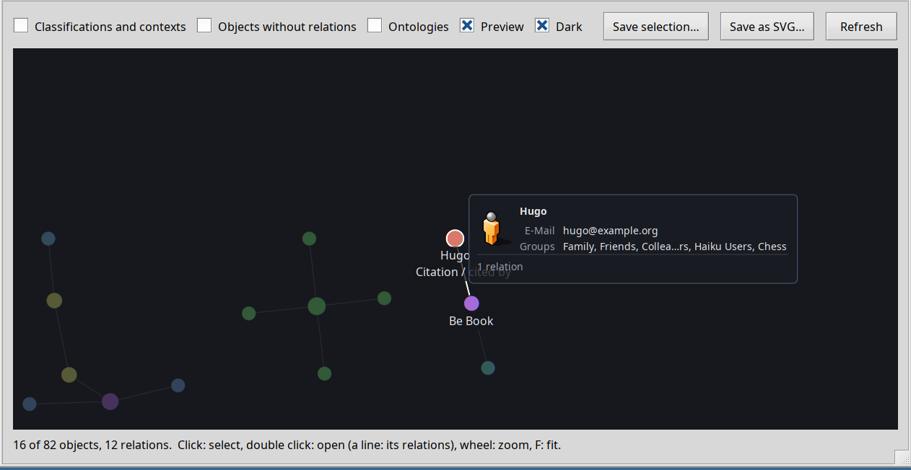
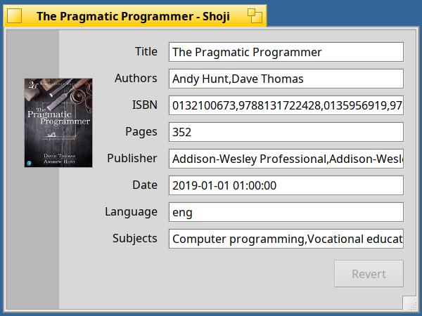

<!--
Draft of the post for the Haiku Community forum (discuss.haiku-os.org). Not published yet. Suggested place: a reply in the topic of the Beta 1/2 announcements
(same topic, "Third-Party"). The images are the ones of the release notes (tag v1.0.0-beta.3). Drafts are not committed.
-->

# SEN 1.0 Beta 3: look closer

Beta 2 showed you the graph of your files. Beta 3 lets you **look closer**: point at a file or a relation, and a card tells you what it is. It also brings **Shoji**, a new editor for the attributes of a file. Still for **Haiku R1/beta6 (x86_64)**, still all in the attributes of your files.

**Cards in the graph.** Rest the mouse on a dot and a card shows the picture or icon of the file, its title, the attributes that matter for its type, and how many relations it has. Rest it on a line and the card says what the relation is, as seen from the nearest end ("cites" at one end, "cited by" at the other), and how many targets it has. The card lights up when you move onto it, and a click opens the file, or the folder of the relations.



**Shoji, a form for the attributes of a file.** Open a contact or a book and see a form instead of a list of attribute names. Changes are stored as you make them. Values that are lists (the authors of a book, the groups of a person) are real lists now, with *Add* and *Remove*. Other types get a form generated from their type definition, and you can put a template of your own in `~/config/settings/shoji/templates/`.



**Lists of values.** SEN FileTypes has the two new fields *List of values* and *Separator* in the dialog of an attribute, so you can say which attributes are lists.

**More than one answer.** When the lookup of **BERT** (books, from OpenLibrary) or **Paperboy** (papers, by title) finds several candidates, a window lets you choose, ordered by how well each one matches. BERT also stores the cover and names the file after the book. In Akita, *Enrich* now goes through the SEN server and picks the plugin that fits the type.

**Also:** the SEN key in the settings starts with the standard shortcut key of Haiku (with the key named, wherever it is on your keyboard) and applies to the knot as well; About SEN and the About windows of the plugins have the striped look of Haiku's alerts; Shoji has an icon and an About window, and carries the version of the SEN 1.0 train (`1.0.0~beta3`); `qpdf` is in the repository now, so the PDF plugin no longer carries its own copy.

**Upgrade** (the knot in the Deskbar is loaded from the server, so stop SEN while the packages are replaced):

```sh
sen stop
pkgman update
sen start       # and, for the new Akita:  akita restart
```

`pkgman update` brings the latest builds (since the first publication of this beta there are small updates to `sen_core` and `shoji`, so you may see a newer revision than in the release notes; Shoji changed its version number from `0.2.0~beta3` to `1.0.0~beta3`, so it simply updates). New here? `pkgman add-repo https://kiri.sen-labs.org/x86_64`, then `pkgman install sen_core sen_plugins akita sen_filetypes shoji` and the ontologies you like.

**One important thing:** this beta needs a Haiku **nightly from hrev60299_1 on**. Akita links against private classes of Haiku, which change from time to time, so its package requires `haiku >= r1~beta6_hrev60299_1` and sets no upper limit; `pkgman update` updates Haiku too and asks for a reboot. A check against the newest nightly runs every day, and the last one (hrev60299_16) passed.

**Good to know:** still a beta, BFS volumes only, the graph shows up to 2000 objects, and Shoji has templates for contacts and books so far.

**Links:** [release notes](https://github.com/sen-laboratories/sento/releases/tag/v1.0.0-beta.3) · [source](https://github.com/sen-laboratories) · package repository `https://kiri.sen-labs.org/x86_64` · if you like where this is going, you can support SEN Labs on [Liberapay](https://liberapay.com/sen-labs/).

Reports are welcome, from "it does not install" to "I would use it for...". If you try Shoji, tell me which type of file you would like a template for.
