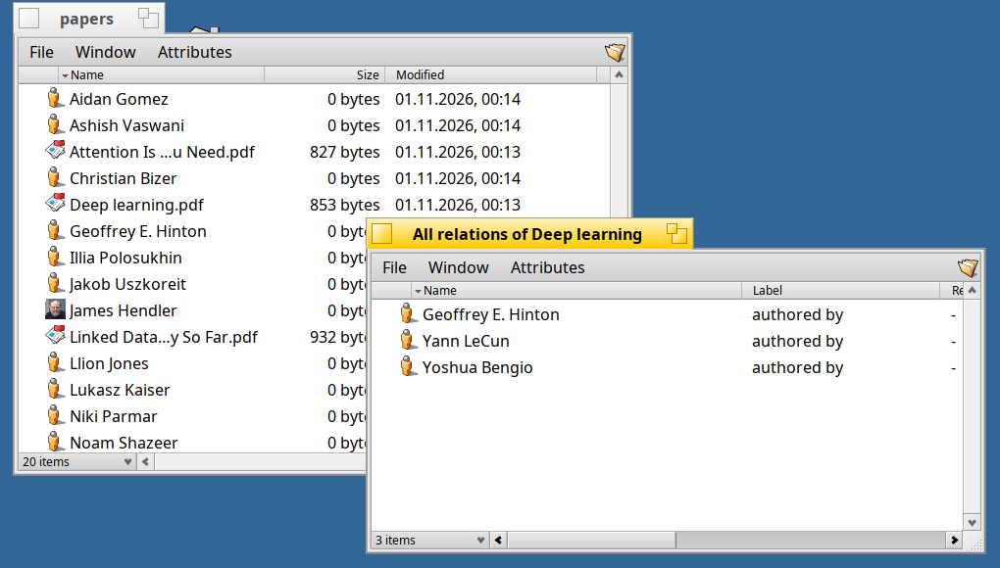
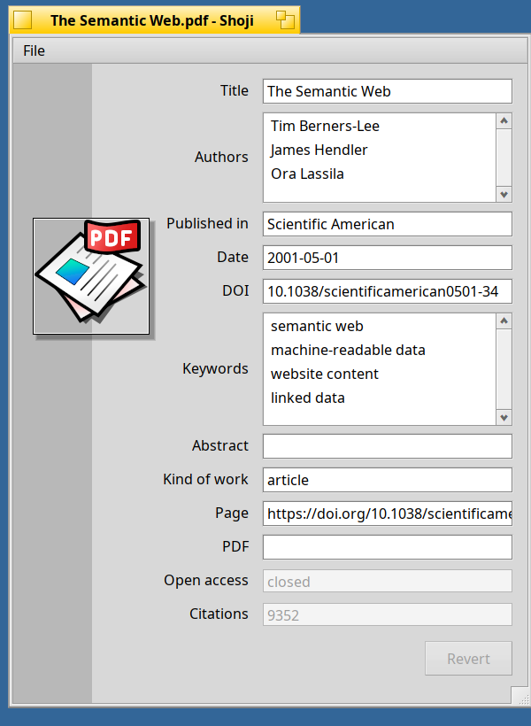

<!--
Draft of the post for the Haiku Community forum (discuss.haiku-os.org). Not published yet. Suggested place: a reply in the topic of the Beta 1/2/3 announcements
(same topic, "Third-Party"). The images are the ones of the release notes (tag v1.0.0-beta.4). Drafts are not committed.
-->

# SEN 1.0 Beta 4: Know your people

Beta 3 let you look closer at a file. Beta 4 looks at **the people behind your files**, and at **several files at once**. Still for **Haiku R1/beta6 (x86_64)**, still all in the attributes of your files.

**Authors become people.** Paperboy (the plugin that enriches PDFs of scientific papers) now also asks **arXiv**, Semantic Scholar and DBLP besides OpenAlex (no keys, no logins), and finds papers without a DOI by their title. A file only becomes a "scientific paper" when a scientific source knows it. The authors become real **person files** next to the paper, with ORCID, description, homepage, birth date and, where Wikimedia Commons has one, a **photo** (with its license and credit), and the *Authorship* relation to the paper. BERT does the same for the authors of books.



**Several files, one menu.** Select more than one file in Akita: *Open related…* offers the relations that all of them have (with Shift: *Open related (common)…*, one folder with what they share), and *New related…*, *Enrich* and dropping into a relation folder work for the whole selection. Files in a relation folder have the icon of their target and open it with the application of its type. Also: a new type (a PDF that became a paper) updates the *Attributes* menu and the columns at once, and the file *Kind* is called *Type* now.

**Shoji** has templates for **papers** and **people**, edits lists **in place** (double click to change or add a value, Delete to remove, `+` to add), shows dates as dates, enlarges the picture when you click it, and has a **settings window**: Shoji can be the application for no file types (default), for all types that have none, or for all types with a template too, and puts everything back when you choose otherwise.



**People.** SEN can add the standard attributes (`foaf:name`, `foaf:mbox`, ...) to the contacts of the People application, beside People's own, which stay. As this adds to the data of another program, the server asks you first, once. Later: `sen migrate person` (`--dry-run` to count).

**Upgrade** (stop SEN while the packages are replaced):

```sh
sen stop
pkgman update
sen start       # and, for the new Akita:  akita restart
```

New here? `pkgman add-repo https://kiri.sen-labs.org/x86_64`, then `pkgman install sen_core sen_plugins akita sen_filetypes shoji` and the ontologies you like. Needs a Haiku **nightly from hrev60299_1 on**, as beta 3.

**Good to know:** Paperboy has support for Semantic Scholar and DBLP already built in but this is not yet tested as it needs a key (S2 limits anonymous requests, DBLP shows a bot check to programs, which is not supported yet); OpenAlex and arXiv did the work in testing. Also still a beta, BFS volumes only.

**Links:** [release notes](https://github.com/sen-laboratories/sento/releases/tag/v1.0.0-beta.4) · [source](https://github.com/sen-laboratories) · package repository `https://kiri.sen-labs.org/x86_64` · support SEN Labs on [Liberapay](https://liberapay.com/sen-labs/).

Reports are welcome. If you try Shoji, tell me which type of file you would like a template for next.
