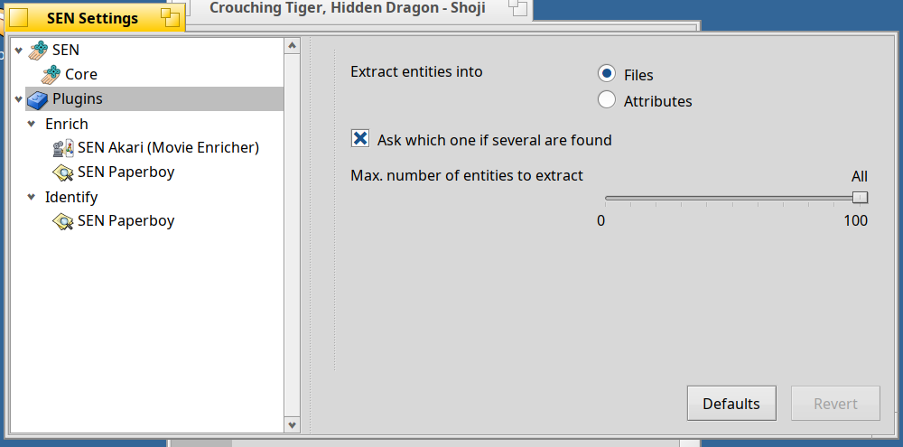
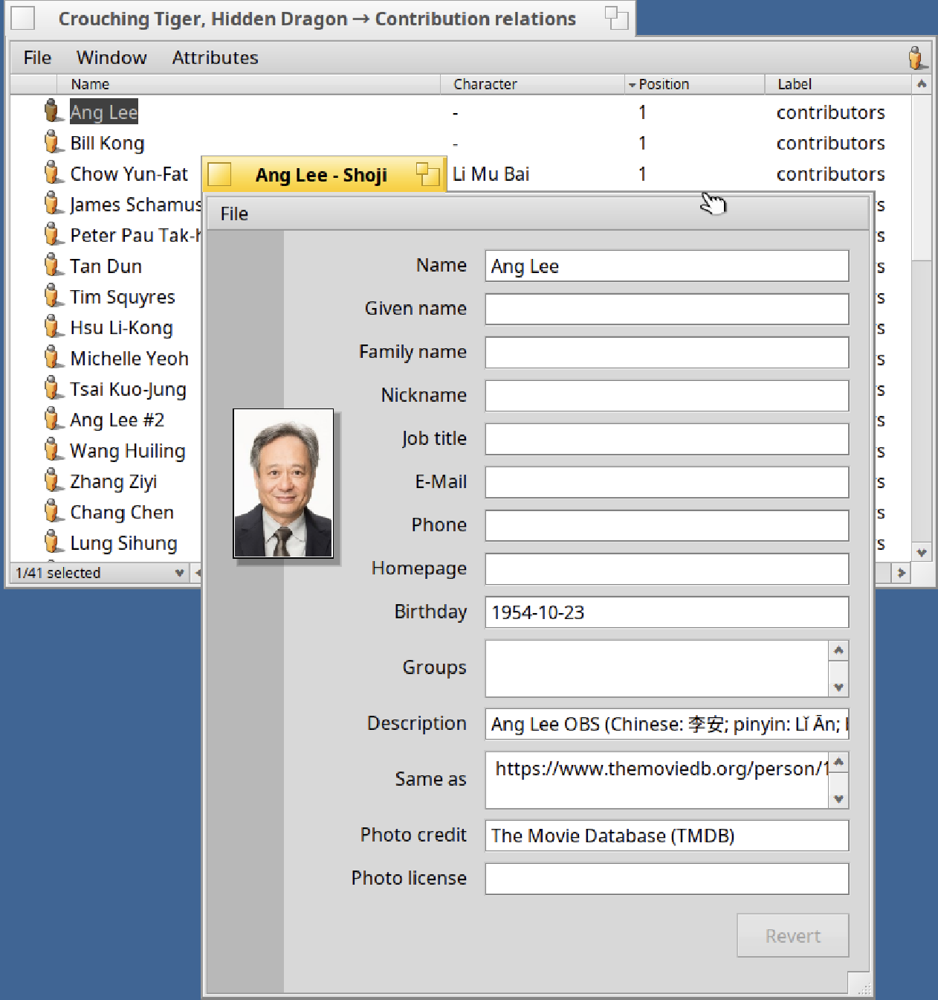

<!--
Draft of the post for the Haiku Community forum (discuss.haiku-os.org). Not published yet. Suggested place: a reply in the topic of the Beta 1/2/3/4 announcements
(same topic, "Third-Party"). The images are the ones of the release notes (tag v1.0.0-beta.5). Drafts are not committed.
-->

# SEN 1.0 Beta 5: Settings, a Library and Movies

Beta 4 looked at the people behind your files. Beta 5 lets you **adjust SEN**, **keeps what it makes in order**, and learns **movies**. Still for **Haiku R1/beta6 (x86_64)**, still all in the attributes of your files.

**One settings window.** *Settings…* in the Deskbar menu of SEN opens a tree: **Core**, the settings that are the same for **all plugins** (where entities go: files or attributes, ask if several are found, how many to extract), and a node for each plugin that has settings of its own (Paperboy, Akari). The forms are made by Shoji, so a plugin only describes its settings. Changes take effect at once.



**A Library for what SEN makes.** The people of a paper, a book or a movie no longer pile up next to the file: they go into **`~/Library`**, one folder per type (*People*, *Books*, *Movies*), and every context has its own (`~/Library/<context>`). New objects are also **associated with the current context** by default (you can switch that off in the Core settings).

**Akari enriches movies.** Choose *Enrich* on a video file: title, year, duration, genres, links and the poster as thumbnail come from The Movie Database (TMDB, you need a free key), and the director, the crew and the cast become **person files** with photo and a **Contribution** relation (role, character, place in the credits) to the movie.



**Shoji** shows durations as `02:16:00`, has sliders, password fields and read-only fields that look like it, and can edit every value of any BMessage in an outline. **The graph is live**: it follows new and changed files and keeps your zoom and selection. Also: *Restart Akita* in the Deskbar menu, a notification while ontologies are installed, and thumbnails that show in **all** icon sizes (the fix is in Akita).

**Upgrade** (stop SEN while the packages are replaced):

```sh
sen stop
pkgman update
sen start       # and, for the new Akita:  akita restart
```

New here? `pkgman add-repo https://kiri.sen-labs.org/x86_64`, then `pkgman install sen_core sen_plugins akita sen_filetypes shoji` and the ontologies you like. Needs a Haiku **nightly from hrev60299_1 on**, as before.

**Good to know:** Akari needs a (free) TMDB key; Semantic Scholar and DBLP in Paperboy are still untested live; BFS volumes only; still a beta.

**Links:** [release notes](https://github.com/sen-laboratories/sento/releases/tag/v1.0.0-beta.5) · [source](https://github.com/sen-laboratories) · package repository `https://kiri.sen-labs.org/x86_64` · support SEN Labs on [Liberapay](https://liberapay.com/sen-labs/).

Reports are welcome. Which type of file should get an enricher next?
