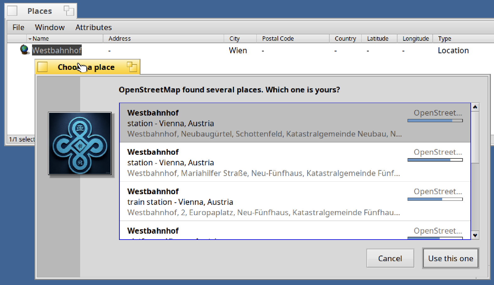
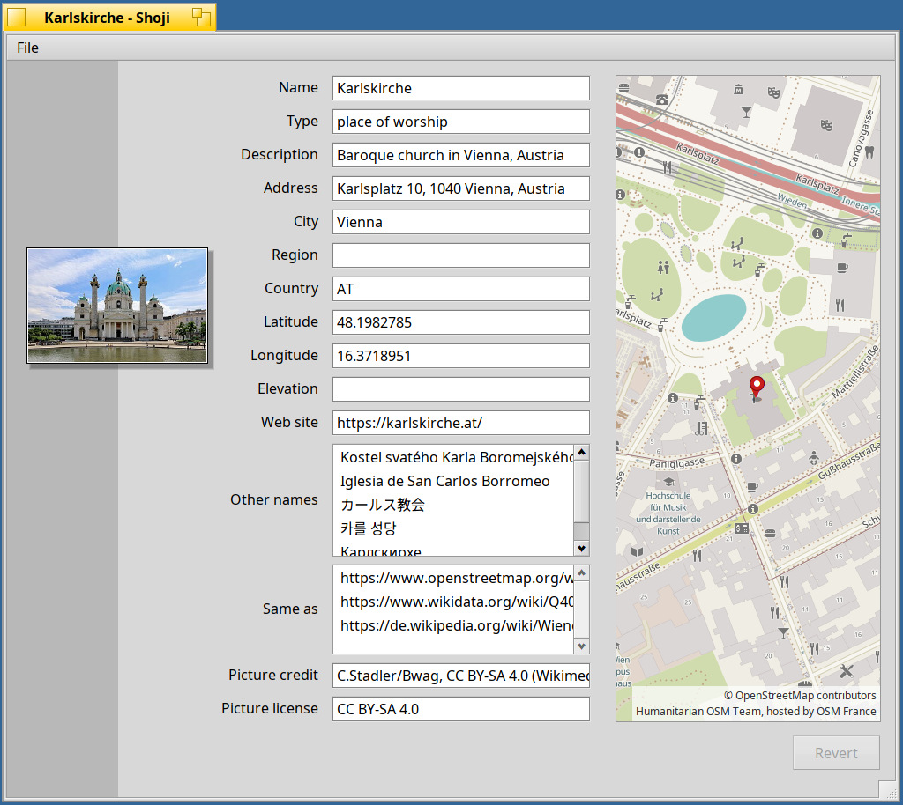
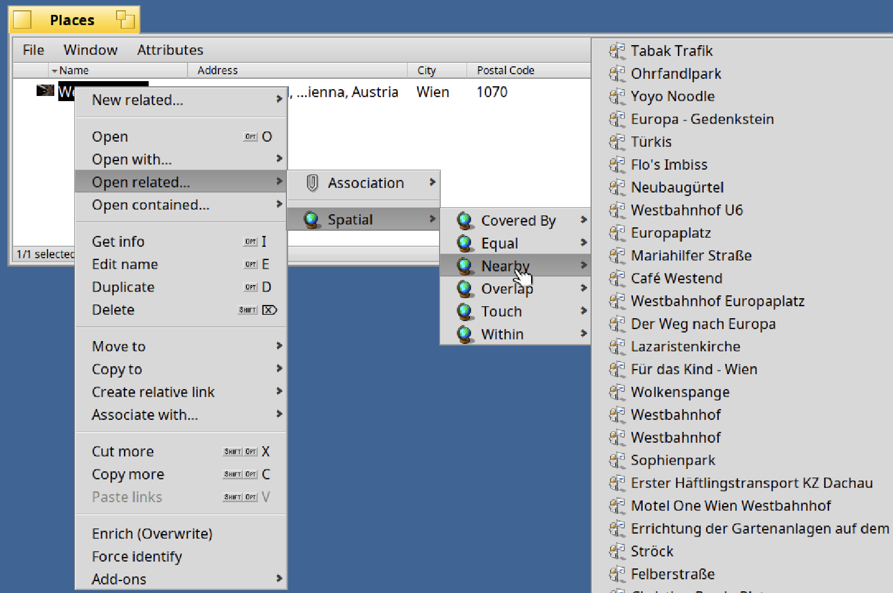
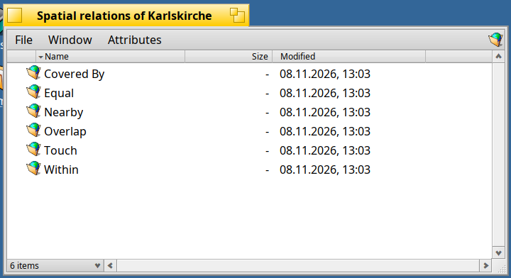

<!--
Draft of the post for the Haiku Community forum (discuss.haiku-os.org). Not published yet. Suggested place: a reply in the topic of the Beta 1/2/3/4/5 announcements
(same topic, "Third-Party"). The images are the ones of the release notes (tag v1.0.0-beta.6). Drafts are not committed.
-->

# SEN 1.0 Beta 6: Places and Spatial Relations

Beta 5 was about making SEN yours. Beta 6 is about **where things are**. Still for **Haiku R1/beta6 nightlies (x86_64)**, and still storing everything natively in file attributes.

**Places and locations.** A new ontology, **SEN Spatial**, introduces **Place** (cultural landmarks and named entities: *Karlskirche*, *Vienna*) and **Location** (pure geographic points and photo positions). Choose *Enrich* and **SUESS**, the new spatial enricher, queries OpenStreetMap and Wikidata to fetch place categories, bounding boxes, boundary outlines, addresses, external links, and high-resolution **photography or crests** with license and attribution. Queries scoped to a city or country search locally (*Westbahnhof* in *Wien* won't suggest Budapest), and transit stations are cleanly distinguished by line and operator. Public querying requires no API key, and photo GPS lookups are opt-in.



**Interactive maps in Shoji.** Places and locations display an integrated **map view** alongside standard attributes. Right-click the map to switch styles on the fly: **OpenTopoMap** (relief), **OpenStreetMap**, **Humanitarian**, or **CyclOSM**—served from free, keyless public tile providers and cached locally for two weeks.



**Dynamic spatial relations.** The new **Spatial** group in *Open related…* introduces relations that are computed on the fly rather than stored statically:
* **Topological containment (RCC-8)**: Evaluates *within / contains*, *covered by / covers*, *touch*, *overlap*, and *equal* dynamically using the GEOS geometry engine and Wikidata administrative hierarchies. They are never out of date when borders change.
* **Nearby points of interest**: Queries surrounding cafés, cultural sights, parks, and transit stops via the Overpass API, complete with category details and distance in meters. Nearby places are automatically created in your Library (`~/Library/Places`) and enriched with photos in the background.



**Relation groups as folders in Akita.** Open an entire relation group (*Open related › Spatial*) to see a window with a dedicated folder for each relation, marked with a distinctive globe icon. Folders load asynchronously on demand (*Fetching relations…*) so nothing is queried unless you inspect it. You can even drag a relation folder (like *Nearby*) to your Desktop or Home directory: the kept folder retains its parameters and re-fetches fresh data whenever opened.



**Desktop integration & system polish:**
* **Restart shortcuts**: *Restart SEN Server* and *Restart Akita* directly from the SEN Deskbar menu.
* **Dedicated context library icons**: Styled folder icons for context libraries.
* **Non-blocking plugin architecture**: Dedicated server worker channels per plugin so remote queries never block local operations.
* **Shared network stack**: Enhanced socket HTTP client shared across plugins with redirect protection and timeouts.

**Upgrade** (stop SEN while packages are updated):

```sh
sen stop
pkgman update
sen start       # and, to reload Akita:  akita restart
pkgman install sen_ontology_spatial sen_plugin_place_enricher sen_plugin_spatial_navigator
```
*(Or install `sen_plugins` to pull in all plugins.)*

New here? `pkgman add-repo https://kiri.sen-labs.org/x86_64`, then `pkgman install sen_core sen_plugins akita sen_filetypes shoji` and the ontologies you like. Requires a Haiku **nightly from hrev60299_1 on**.

**Good to know:** Searching by name alone without a city or country queries worldwide (local positioning is planned for the next release); Overpass queries can take up to 30 seconds in dense areas; places not indexed in Wikidata lack photography. BFS volumes only; still a beta—likely the last before release candidates.

*Map data © OpenStreetMap contributors (ODbL); descriptions from Wikidata (CC0); pictures from Wikimedia Commons under their respective licenses.*

**Links:** [Release notes](https://github.com/sen-laboratories/sento/releases/tag/v1.0.0-beta.6) · [Source code](https://github.com/sen-laboratories) · Package repository `https://kiri.sen-labs.org/x86_64` · Support SEN Labs on [Liberapay](https://liberapay.com/sen-labs/).

Reports and feedback are always welcome. What would you like to see on the map next?
