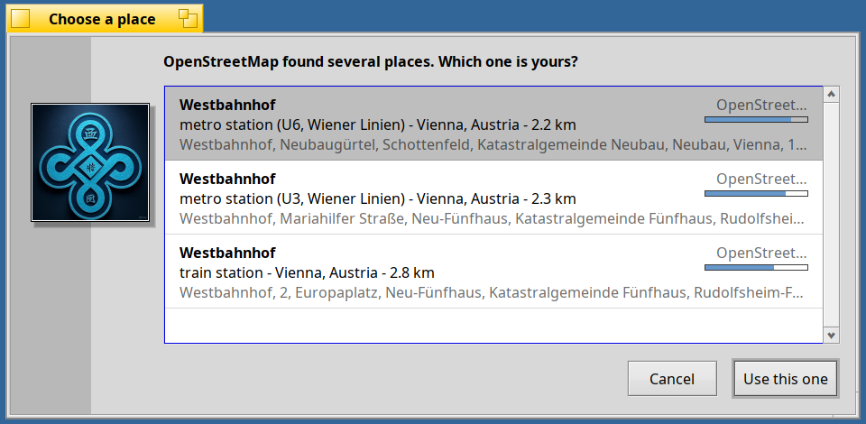
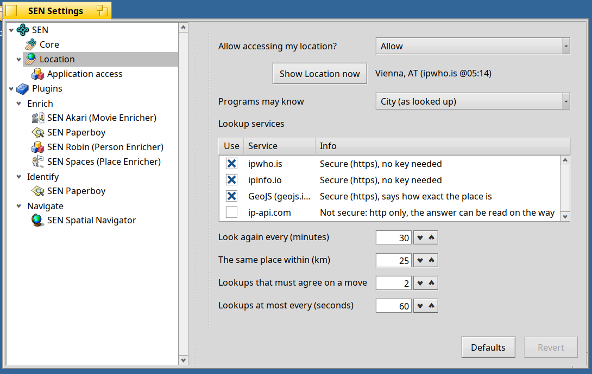
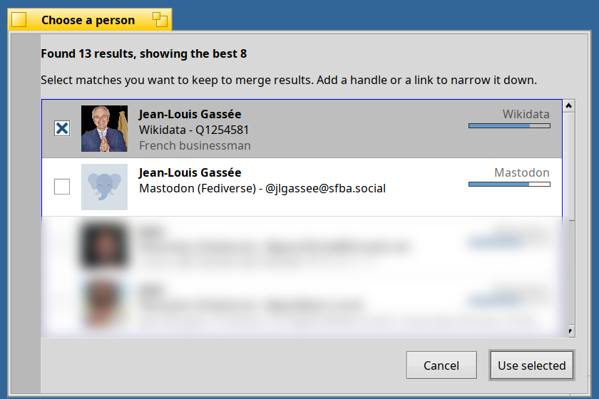
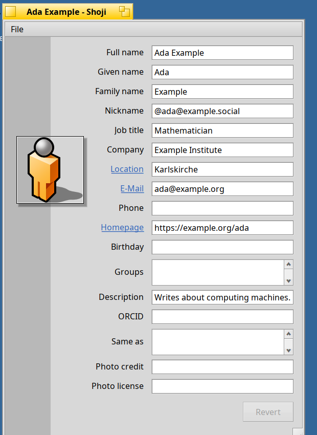

# SEN 1.0 Beta 7 "Sofia": People and Places

Beta 6 brought places and spatial relations. Beta 7 connects those places to **people** and gives your desktop a privacy-first sense of **where you are**. Still for **Haiku R1/beta6 nightlies (x86_64)** (from `hrev60299_1` on), and still storing everything natively in file attributes.

**Basho: privacy-first location awareness and context.** In Beta 6, searching for a place by name alone—like *Westbahnhof* without a city or country—searched worldwide. Beta 7 introduces **Basho** (*place* in Japanese, and a nod to the poet Matsuo Bashō), an independent ambient location daemon for Haiku, and pairs it with **SEN Spaces** (formerly SUESS):
* **Location-aware enrichment**: With Basho running, Spaces automatically biases unconstrained place searches toward your current region and ranks candidates by distance right in the chooser dialog. Only a coarse regional bounding box (tens of kilometres across)—never your exact coordinates—is sent to OpenStreetMap.
* **Privacy and control by design**: Basho never touches the network silently; it asks for permission before its first keyless IP geolocation lookup and caches fixes locally with anti-jitter filtering. In **Settings › SEN › Location**, you can test the current fix (*Show Location now*), reorder lookup providers, cap the maximum precision shared with apps (*city*, *region*, *country*, or a custom kilometre radius with grid-snapped coarsening), and manage per-app permissions in the **Application access** table. A companion `location` CLI tool gives full control from the Terminal, including manual coordinate overrides for offline or VPN use.
* **Smarter place lookups**: Spaces now queries venue names and street addresses together (keeping your venue title if OpenStreetMap only knows the street) and filters redundant transit platforms so the main station stays at the top.





**Robin: enriching people across the open web.** **Robin** is a new enrichment plugin for Person entities and legacy Haiku *People* contacts. Rather than scraping closed networks, Robin gathers photos, biographies, roles, organizations, locations, verified links, and activity feeds from open services where people publish their own profiles: **Bluesky, Mastodon (Fediverse), GitHub, Wikidata, ORCID, Gravatar/Libravatar**, and personal **homepages and RSS/Atom feeds**.
* **One priority list**: Drag rows in *Settings › Plugins › Enrich › SEN Robin* to set your preferred source order and toggle individual services on or off.
* **Direct lookups and multi-service merging**: Existing profile links, handles, homepages, or e-mail addresses (hashed locally with SHA-256 for Gravatar/Libravatar) are queried directly; otherwise Robin searches by name and lets you select multiple matching candidates at once. It merges details in priority order without overwriting existing attributes, picks the highest-resolution portrait, and saves the chosen links for future updates.
* **Gentle name correction and People compatibility**: If an online profile spells a name slightly differently from your file, Robin lets you keep yours, adopt the profile's spelling, or update and rename the file—and can populate empty `META:name` and `META:nickname` attributes for Haiku's native *People* app.
* **Recent posts as a live relation**: When Robin finds an RSS/Atom feed, Mastodon outbox, or Bluesky feed, it enables **Open related… › Status**, opening a folder of the person's recent posts as clean Markdown files refreshed on demand when over an hour old.



**Shoji: connecting people to places.** In a Person window, **Homepage**, **E-Mail**, and **Location** are now clickable links. Clicking **Location** asks Spaces to resolve the place, creates a standalone Place entity in your Library, links the person to it, and opens its interactive map window (with subsequent clicks opening it immediately). Person windows also gain dedicated fields for *Full name*, *Nickname*, *Company*, *Location*, and *ORCID*; map views show a non-blocking *Loading map…* indicator with graceful tile timeouts; and Shoji's replicant form host now supports full drag-and-drop reorderable tables for the new Robin and Basho preference panes.



**Akita & desktop polish:**
* **Natural opening for entities**: Double-clicking an entity file in Akita opens it with the app for its semantic type (so Person files open directly in Shoji).
* **Enrich automatically on demand**: A new shared setting in *Settings › Plugins › Enrich* triggers enrichment automatically when you open a dynamic relation (like *Nearby* on an unpositioned place or *Status* on an unenriched person).
* **Cleaner dynamic folders**: Opening dynamic or remote relation folders shows a barber-pole *Resolving relations…* indicator in the status bar instead of a temporary placeholder item.
* **Everyday polish**: A new **Library** submenu in the SEN Deskbar menu, exact package revisions in About dialogs (`1.0.0-beta.7-7`), more concise settings tooltips, and `Esc` cleanly canceling list/table cell edits.

**Upgrade** (stop SEN while packages are updated):

```sh
sen stop
pkgman update
sen start       # and, to reload Akita:  akita restart
pkgman install basho sen_plugin_person_enricher
```
*(Updating `sen_plugins` pulls in Robin automatically; `basho` is optional and enables local search bias in Spaces as well as the Location settings pane.)*

New here? `pkgman add-repo https://kiri.sen-labs.org/x86_64`, then `pkgman install sen_core sen_plugins akita sen_filetypes shoji basho` and the ontologies you like. Requires a Haiku **nightly from hrev60299_1 on**.

**Good to know:** Basho is opt-in and asks before querying IP geolocation services (without it, Spaces works just as in Beta 6); in Robin, unlinked enabled services will prompt by name on re-enrichment unless disabled, and `--auto` mode picks the top match automatically; BFS volumes only.

**Links:** [Release notes](https://github.com/sen-laboratories/sento/releases/tag/v1.0.0-beta.7) · [Source code](https://github.com/sen-laboratories) · Package repository `https://kiri.sen-labs.org/x86_64` · Support SEN Labs on [Liberapay](https://liberapay.com/sen-labs/).

Reports and feedback are always welcome. Who—or where—are you enriching first?
