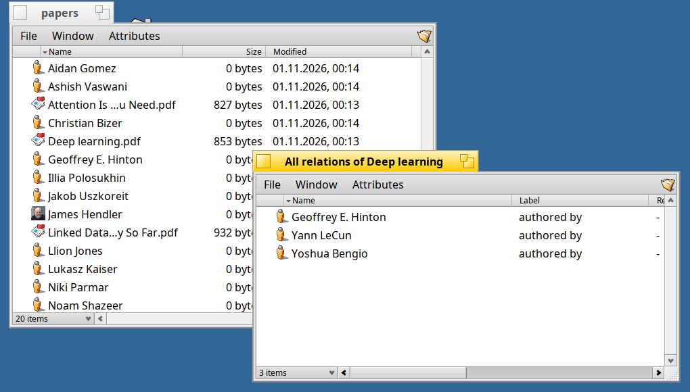
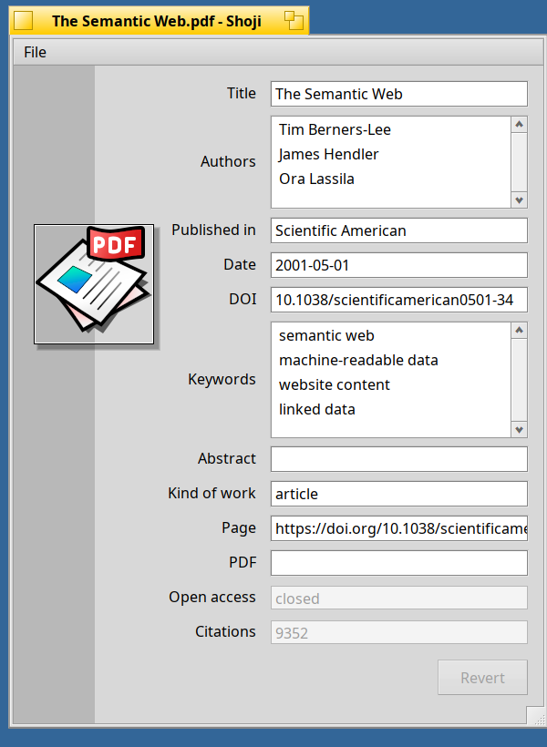
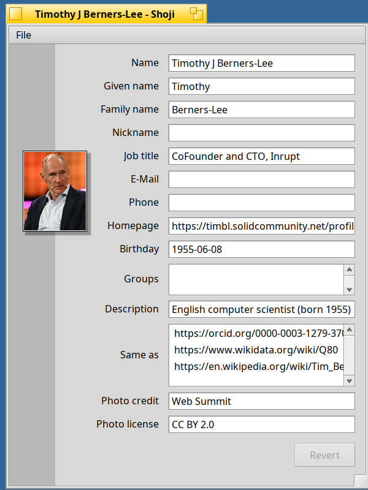
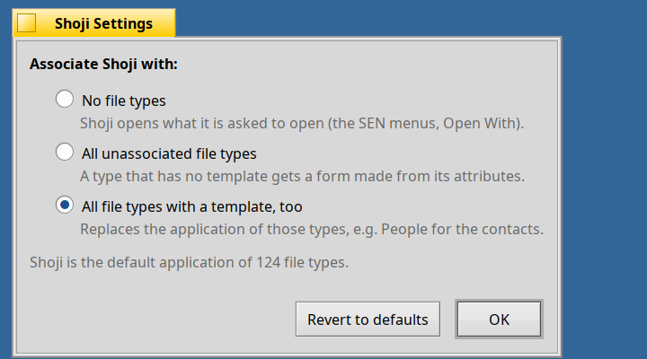
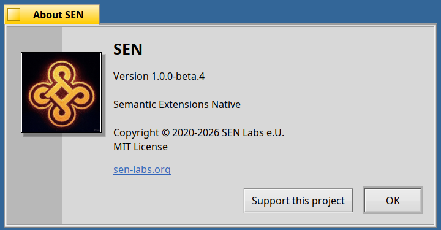

<!--
SPDX-License-Identifier: MIT
SPDX-FileCopyrightText: 2026 SEN Labs e.U.
-->

# SEN 1.0.0 Beta 4 "Sofia" — *Know your People*

> Knowledge is created only by people. It resides in the social interactions and shared context between individuals.
— Adapted from Ikujiro Nonaka (The Knowledge-Creating Company)

Beta 3 let you look closer at a file. Beta 4 is about **the people behind your files** and about **several files at once**: the authors of a paper become real person files (with their ORCID, a photo and the relation to the paper), the relation menus of Akita work for a
selection of files, and **Shoji** learns to be the form for all of it: a template for papers and people, lists that you edit in place, and a settings window.

**SEN (Semantic Extensions Native)** on **Haiku R1/beta6 nightlies (x86_64), from hrev60299 on**, as with beta 3. If you have beta 3 installed, `pkgman update` brings you here (see *Upgrading* below).

> [!IMPORTANT]
> **SEN follows the Haiku nightlies**, as before: the packages of Akita and SEN FileTypes require `haiku >= r1~beta6_hrev60299_1` and set no upper limit, so `pkgman` never holds your Haiku back. They are built on hrev60299+16.
> `abi-check.sh` in the [akita](https://github.com/sen-laboratories/akita) repository compares them with the newest nightly every day; a new build follows when a nightly breaks Akita.

## Papers find their authors

**Paperboy**, the enrichment plugin for papers, has learned three things.

* **More sources, still without a key or a login.** After OpenAlex it asks **arXiv**, **Semantic Scholar** and **DBLP** (in this order, by how much work each answer is). A paper without a DOI is found by its title and then looked up by its OpenAlex id. **A file only becomes a
  scientific paper (the semantic type `document/scientific-paper`) when a scientific source knows it**; a PDF with a title that nobody knows stays what it was. Each source can be switched off in `~/config/settings/sen/paperboy.settings`, and the **About** window says what Paperboy does and which sources it uses.
* **The authors become people.** For every author (up to ten, `max_authors`) Paperboy makes a **person file** next to the paper, with the **ORCID** (name, employment) and **Wikidata** (description, homepage, birth date, and the **photo** from Wikimedia Commons with its license and credit). The person gets the **Authorship** relation to the paper,
  and the photo is its thumbnail, so authors show up with their face in Akita and in the graph. A person that already exists (same ORCID, or same name) is updated, not made twice. `authors` in that file is `all` (default), `orcid` (only authors that have an ORCID) or `no`.
* **Wikimedia without trouble.** Haiku's own HTTP client throws on a response header with an empty value, which Wikimedia sends (`x-analytics:`). Paperboy now reads such hosts over a small HTTP/1.1 client of its own on a secure socket, once it has seen the failure.



The icon of a scientific paper is new (`File_Text_Open.svg` of the [haiku-icons](https://github.com/darealshinji/haiku-icons) by darealshinji, MIT), and the **Authorship** relation accepts documents, PDFs and EPUBs now, not only books.
**BERT** (books) makes its authors in the same way, with photos, drops the attributes that an earlier lookup wrote when it narrows the search ("it found nothing because of my own old answer"), and as a last resort searches for the file name.

## Several files, one menu

In **Akita**, select more than one file:

* **Open related…** offers the relation types that **all** the selected files have, not those that any of them has. With **Shift** the item is *Open related (common)…*: one folder with the targets that the files share.
* **New related…**, **Enrich** (one file after the other) and dropping files into a relation folder work for the whole selection; a folder of common relations says why nothing can be dropped into it.
* **Relation folders show what is at the other end.** A file in a relation folder has the icon of its target, and a double click opens the target with the **application of its type**. If no navigator knows the relation, the file is opened with the default application, so nothing stays as a "relation file" that opens nothing.
* **A new type shows at once.** When a PDF becomes a scientific paper, the *Attributes* menu and the columns of the open windows follow; when the last file of a type leaves the folder, its attributes leave the menu.
* The file **Kind** is called **Type** in the columns so to not be confused with the standard Relation property `Kind`.

**Navigators are named for their relation** now: *Authorship*, *Knows* (new: the relationships between people, from `sen_plugin_personal_relation_navigator`), *Reference* (document and text references replace the earlier PDF and text navigators), and the general *Relation* navigator. The developer guide has the details.

## Shoji: people, papers, lists, and settings

Shoji comes with templates for the new types, a form of its own for each, and gets a few things that you asked for:



* **Scientific papers** (`document/scientific-paper`): title, authors, where published, date, DOI, keywords, abstract, kind of work, the places to read it, and the open access status and the citations that a service reported. A file is shown with the template of its **semantic type** (`META:TYPE`), if it has one, else of its file type.
* **People** (`entity/x-vnd.sen-labs.entity.person`): name, given and family name, job, e-mail, phone, homepage, birthday, groups, description, and what Paperboy brings: **Same as** (ORCID, Wikidata, Wikipedia: a list), and the **credit and license of the photo**.



<sub>Photo of Tim Berners-Lee: Web Summit, [CC BY 2.0](https://creativecommons.org/licenses/by/2.0/), via Wikimedia Commons.</sub>

* **Dates are dates.** A day that a plugin stores (midnight UTC) was shown as `1955-06-08 01:00:00`, a time of day that moves with your time zone. It shows as `1955-06-08` now, and a day that you type is stored the same way.
* **Lists are edited in the list.** No *Add* and *Remove* buttons: a **double click** on a value changes it, a double click on the empty part below the values adds one, **Delete** removes the selected value, **+** (or Insert) adds one, and the context menu has *Add…* and *Delete*. Enter or leaving the field keeps what you typed, Escape takes it back. Lists are as high as their values need (two to five rows, then they scroll).
* **Click the picture** (the cover, the photo) and it shows at its full size in a window over the form; a click, Escape or another window puts it away.
* **Settings** (File menu, or Shoji started without a file): *Associate Shoji with:* **no file types** (the default: Shoji opens what it is asked to open, from the SEN menus or *Open With*), **all unassociated file types** (a type that no application handles gets a form made from its attributes) or **all file types with a template, too** (this replaces the application of those types, People for contacts). Shoji remembers what each type had before, so choosing *no file types* puts everything back, and *Revert to defaults* does that. The system's own file type database is never changed.



* Shoji **quits with its last window**, and its signature is fixed to `application/x-vnd.sen-labs.shoji` to align with other components of SEN.

## People of the People application

The contacts of Haiku's **People** application keep their data in `META:*` attributes. SEN can add the standard ones (`foaf:name`, `foaf:mbox`, `foaf:phone`, `foaf:homepage`, `foaf:nick`, and the groups as a list), so that Shoji, the graph and the queries see them like any other person. **Nothing of People is changed**: the new attributes are added beside the old ones, only where they are missing.

Because this adds to data of another program, **the server asks you first**, once, when it finds contacts: *Not now*, *Never*, or *Add attributes*. You can ask for it later (or look first) from the Terminal:

```sh
sen migrate --dry-run person    # count what would be added
sen migrate person              # the same question, asked now (also: sen migrate application/x-person)
```

The first kind of migration is new as well: **numbered, repeatable steps** that bring the data that older versions made (renamed relation types…) to what this version expects, run when the server starts (`sen migrate` lists them).

## About eye candy

The pictures of **About SEN** and the dialogs of the plugins and of Shoji have a thin black and white frame and a soft shadow to the right and below, and a click on a picture in such a dialog shows it larger:



## Under the hood

* **No threads of our own** in the server: the enrichment queue, the migrations, and the windows for Info, Check and Graph and the ontology installer use one worker looper; the chooser of the plugins is run by a looper too.
* **Ontologies** (`0.1.0-28`): *People* has `schema:sameAs`, the photo (page, license, credit); the personal relation has the base type *PersonalRelation* (label "knows"); the old person stays a compatible type; the relation property is *Relation Kind* and the one of a paper *Kind of Work*.
* **For developers** (sento): `SenStripeDialog.h` has the picture with frame, shadow and the full-size view (`StripeView(picture, full)`); navigators that open a target share `TargetOpener`; the developer guide describes the naming of navigators.

## Packages

25 packages in the repository **Kiri**, among them:

* `sen_core`, `sen_oni`, `akita`, `sen_filetypes`: `1.0.0~beta4`; **`shoji`: `1.0.0~beta4-3`**.
* The seven ontology packages are at `0.1.0-28`.
* All twelve plugin packages are `~beta4`, and `sen_plugins` (`1.0.0~beta4`) requires all of them. New: `sen_plugin_personal_relation_navigator`, `sen_plugin_authorship_navigator`, `sen_plugin_document_reference_navigator` and `sen_plugin_text_reference_navigator`, the last two replace the earlier PDF and text navigators.

## Upgrading from Beta 3

Stop SEN while the packages are replaced (the knot in the Deskbar is loaded from the server) and start it again afterwards:

```sh
sen stop
pkgman update
sen start       # and, to have the new Akita:  akita restart
```

The first start with beta 4 asks about the contacts of People (above), if you have any. New here? See *Quick Install* in the notes of beta 3: `pkgman add-repo https://kiri.sen-labs.org/x86_64`, then `pkgman install sen_core sen_plugins akita sen_filetypes shoji` and the ontologies you like.

## Known limitations

* **Semantic Scholar and DBLP are in, but could not be tested live without a key.** Semantic Scholar answers anonymous requests only at a low rate, and DBLP currently shows a bot-check page to programs, which Paperboy does not try to get around. Both are read as soon as they answer; OpenAlex and arXiv are the sources that did the work in testing.
* The **job and the description** of an author come from the ORCID profile when it has them, as the author wrote them, so they can be in another language than yours (a French one was seen); Wikidata is asked in English. Many authors have no photo on Wikimedia Commons, and then keep the icon of a person.
* BFS volumes only, as before; the graph shows up to 2000 objects.
* A Haiku older than hrev60299_1 cannot be used with this beta (Akita would not load there).

## What comes next

Planned improvements besides bug fixes and integrating beta-4 feedback are:
* SEN settings UI overhaul for core, also:
  * integrate plugin settings into the UI: plugins expose their settings as an archived BView that is integrated into SEN settings.
* a movie file enricher
* templates for more types

Then there will be release candidates for the 1.0 train; in parallel SEN 2.0 "Gnosis" (the unified registry of semantic types, an Akita that is an information browser with Shoji and the graph built in) moves ahead.

## Your support is essential

Please consider hitting the "Support" button in the About dialog and contribute to the ongoing development of SEN, or simply donate right from here to [SEN Labs Liberapay](https://liberapay.com/sen-labs/).

## Feedback & Community

* **Issue Tracker & Source:** [https://github.com/sen-laboratories](https://github.com/sen-laboratories)
* **Package Repository:** `https://kiri.sen-labs.org/x86_64`
* **Community Discussion:** Haiku Community Forums
