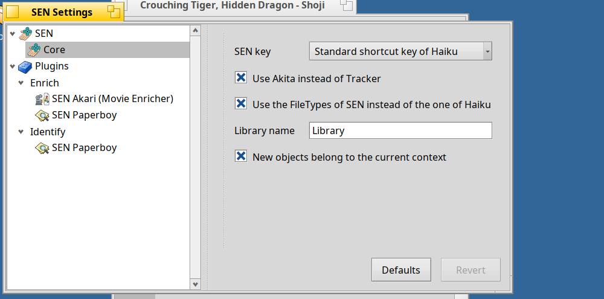
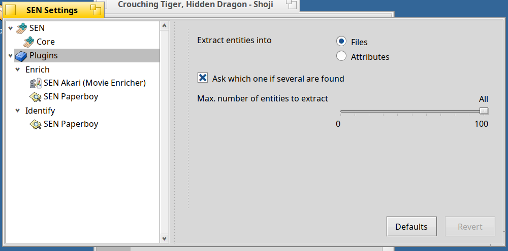
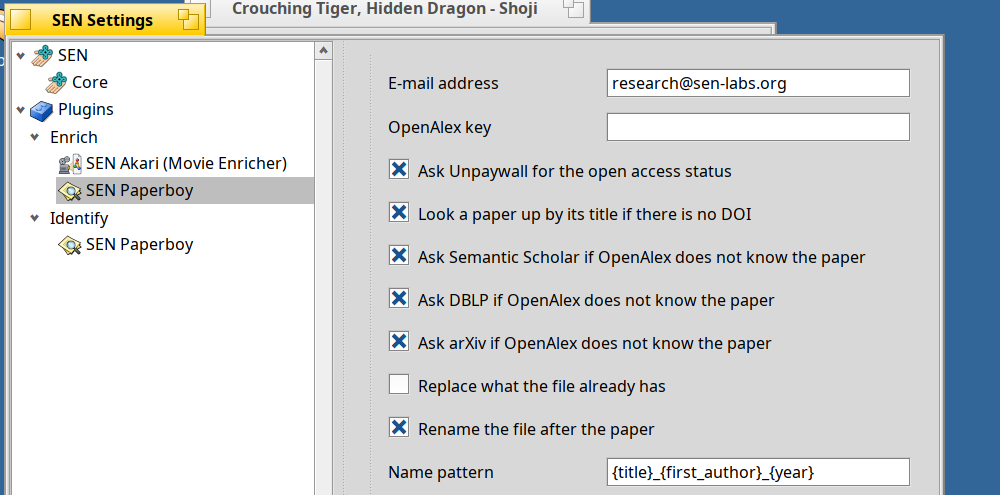
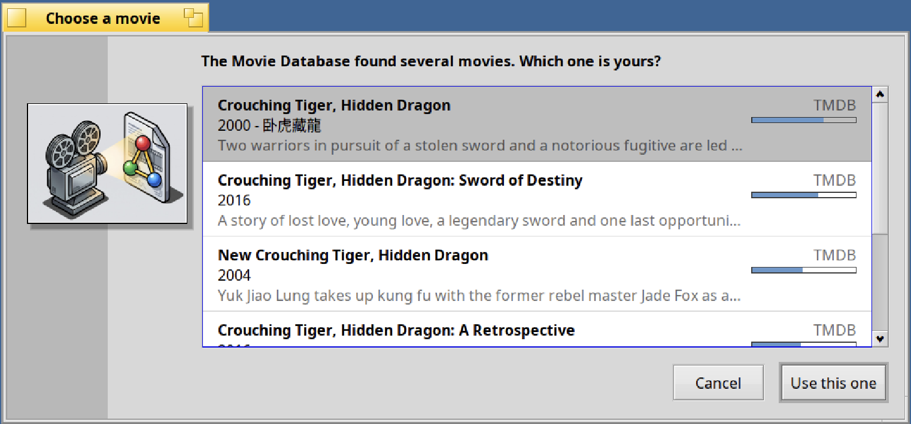
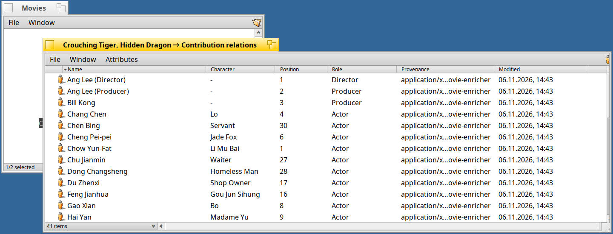
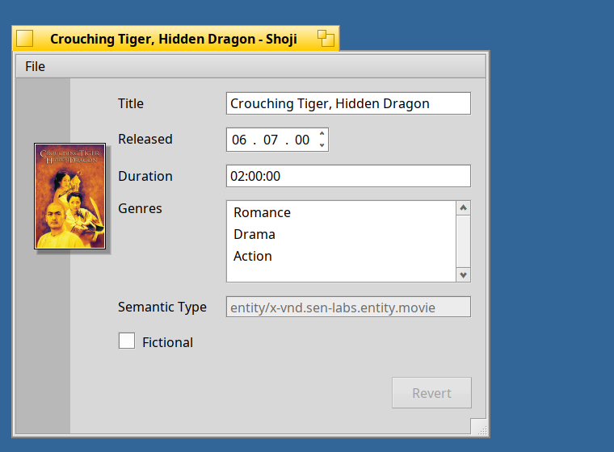
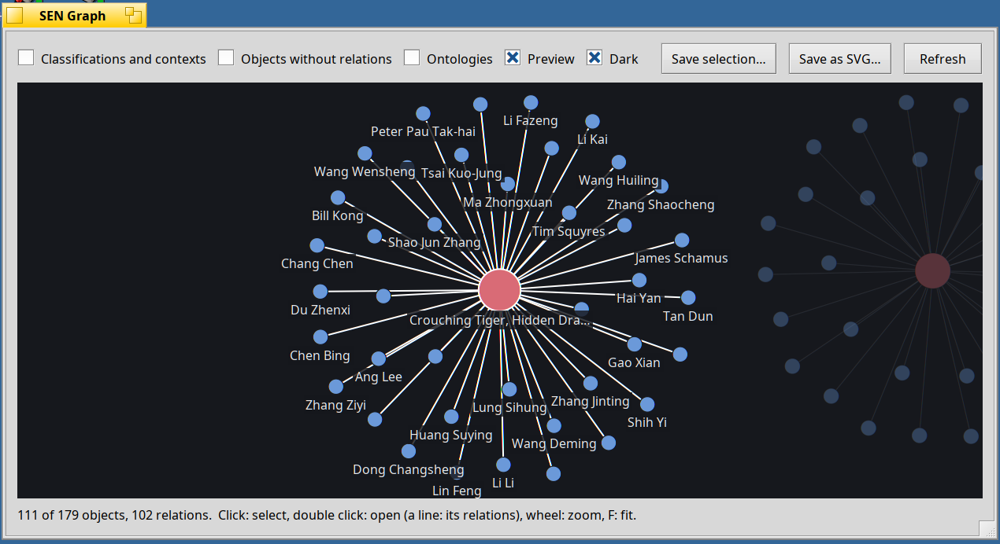
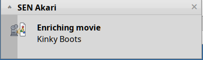
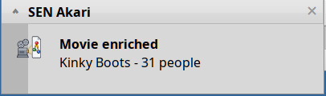

<!--
SPDX-License-Identifier: MIT
SPDX-FileCopyrightText: 2026 SEN Labs e.U.
-->

# SEN 1.0.0 Beta 5 "Sofia" — *Settings, Library and Movies*

> The most valuable thing a tool can do is to stay out of the way, and to be easy to adjust when it does not.

Beta 4 brought the people behind your files into focus. Beta 5 is about **making SEN yours** and **keeping things in order**: a unified **settings window** brings preferences for SEN and its plugins together in one place, newly extracted entities go into a dedicated **Library** instead of scattering across your folders, a new plugin—**Akari**—enriches **movies** with rich metadata, cast, and crew, the **graph view is now live and reactive**, and numerous rough edges have been polished throughout the system.

**SEN (Semantic Extensions Native)** runs on **Haiku R1/beta6 nightlies (x86_64), from hrev60299 on**. If you have beta 4 installed, `pkgman update` brings you here (see *Upgrading from Beta 4* below).

> [!IMPORTANT]
> **SEN follows the Haiku nightlies**: packages for Akita and SEN FileTypes require `haiku >= r1~beta6_hrev60299_1` and set no upper version limit, so `pkgman` never holds your system back.
> An automated ABI check (`abi-check.sh` in the [akita](https://github.com/sen-laboratories/akita) repository) verifies compatibility against every new Haiku nightly, triggering a rebuild whenever a nightly introduces breaking changes.

## One place for the settings

Choose **Settings…** from the SEN menu in the Deskbar. The new settings window provides a clear, hierarchical view: **SEN › Core** for system-wide options, and a **Plugins** tree organizing shared options and individual plugin configurations. The form interface is generated natively by **Shoji** as an embedded replicant view, ensuring settings look and behave consistently with the rest of SEN while freeing plugins from having to draw custom windows.



* **Core Settings**: Replaces the previous configuration dialog with a streamlined view of global options—including the SEN modifier key, Akita file manager integration, FileTypes management, the configurable **Library folder name**, and automatic context association for new objects.
* **Shared Plugin Settings**: Configures common enrichment behaviors globally across all plugins in one place:
  * **Extract entities into**: Choose between **Files** (creating standalone entity files for authors, actors, directors) or **Attributes** (writing names directly into file attributes).
  * **Ask which one if several are found**: Controls whether plugins prompt you with an interactive candidate chooser when multiple results match a search.
  * **Max. number of entities to extract**: A labeled slider from *None* to *All* (unlimited).

  

* **Plugin-Specific Settings**: Plugins that require custom configuration appear as dedicated nodes. **Paperboy** lets you configure contact details, OpenAlex credentials, search sources, and file-renaming patterns; **Akari** provides options for TMDB API credentials and preferred language. Plugins without custom settings are neatly omitted.
* **Live validation**: Input values are validated directly by the respective plugin, with descriptive feedback for invalid entries. Sensitive information (such as API tokens) is securely masked in password fields.
* **Instant updates**: Plugins reload their configuration dynamically for each request, so your changes take effect immediately without requiring application or daemon restarts.



## A Library for your Things

In previous versions, entity files created during enrichment (such as authors extracted from papers or books) were placed directly alongside the source file, often cluttering working directories and Downloads. Beta 5 introduces a contextual, structured **Library**:

* **Centralized structure**: By default, new entities are saved to **`~/Library`** (configurable in *SEN › Core*), neatly organized into pluralized type folders: *People*, *Books*, *Movies*, and more.
* **Context-aware libraries**: Each context maintains its own distinct library folder (e.g. `~/Library/Research`), keeping entities organized according to your active project.
* **Smart deduplication**: Existing entity files are resolved by identifier and updated in place wherever they reside on your filesystem. The Library specifically organizes where *new* entities are created.
* **Command-line access**: `sen --library <type>` resolves and prints the target path for any entity type (use `--create` to ensure directory creation, or `--context <name>` to query a specific context).

**New objects belong to the current context.** Newly created files, relations, and extracted entities are now automatically associated with the active context by default. This makes working within a context effortless: everything created while a context is active joins that context automatically. You can turn this off in *SEN › Core* if you prefer manual association.

## Akari: movies, their crew and their cast



**Akari** (*light* in Japanese) is a new enrichment plugin that brings rich film metadata and relation graphs to your video files using [The Movie Database](https://www.themoviedb.org) (TMDB). Simply select a video file in Akita and choose **Enrich**:

* **Movie metadata**: Identifies titles and release years from existing file attributes or standard file-naming patterns (e.g. `Blade Runner 2049 (2017).mp4`). When multiple titles match, an interactive chooser lets you pick the correct one, sorted by relevance and popularity. The file receives the **Movie** semantic type (schema.org compliant) along with duration, release date, synopsis, genres, countries, languages, external links (TMDB, IMDb, Wikidata, Letterboxd), and high-resolution poster artwork as its thumbnail. Existing metadata is preserved by default, or refreshed with *Enrich (Overwrite)* (Shift).
* **Cast and crew as people**: Directors, key crew members (writers, producers, composers, cinematographers, editors), and cast members are created as rich **Person** entity files in `~/Library/People`, complete with biographies, birth dates, web links, and photos.
* **Detailed contribution relations**: Each contributor is linked to the movie through a **Contribution** relation recording their role, character name (for actors), and billing order. If an individual holds multiple roles (e.g. both Director and Writer), distinct contributions are created and clearly distinguished by role in relation views (such as *Ang Lee (Director)* and *Ang Lee (Producer)*).



* **Configuration**: Requires a free TMDB API key or API Read Access Token, easily configured in *Settings › Plugins › Enrich › SEN Akari*.
* **Standardized schema**: The movie ontology follows schema.org specifications, introduces an iconic video cassette icon, and formats multi-value attributes (genres, countries, links) cleanly as native lists in Shoji.

> This product uses the TMDB API but is not endorsed or certified by TMDB. Data and imagery courtesy of TMDB.

**Paperboy** and **BERT** have also been updated to place new entities into the Library and adhere to the shared plugin settings.

## Shoji



* **Universal message inspector & form host**: Shoji can inspect and edit any `BMessage` structure in place within a unified outline view. This capability also serves as the host for the new settings interface.
* **Human-readable durations**: ISO 8601 duration values (e.g. `PT2H16M`) are presented and edited as intuitive time strings (`02:16:00`), with bidirectional parsing and validation.
* **Control refinements**:
  * Secure password fields mask sensitive configuration keys.
  * Labeled sliders clearly indicate minimum and maximum boundaries (*None* to *All*).
  * Read-only fields are clearly distinguished while keeping their labels fully legible.
  * Date picker controls adopt native Haiku list-view style arrows.
* **Window behavior**: Full-size image popup views now close automatically with their parent window.

## The graph is live



* **Reactive updates**: The relationship graph actively monitors tracked files and listens to live queries for added or removed objects. Changes update smoothly after a brief debounce period to prevent visual flicker during batch enrichments, all while preserving your current zoom level, pan position, and selection.
* **Persistent tracking**: Objects in focus are resolved by ID, maintaining graph tracking even after files are renamed.
* **Graceful empty states**: When a requested file has no connections yet, the window displays an informative status message ("*<name> has no relations*") and connects automatically as soon as relations are established.

## Desktop integration & polish

* **Restart Akita from Deskbar**: A new *Restart Akita* item in the SEN Deskbar menu lets you quickly reload the enhanced file manager after updating packages.
* **Real-time enrichment notifications**: Akari, Paperboy, and Book Enricher now display immediate desktop notifications when enrichment begins ("Enriching movie…"), updating seamlessly in place when processing finishes.

   

* **Adaptive thumbnail scaling**: File thumbnails (such as movie posters and book covers) now automatically scale to fit all Tracker icon view sizes.
* **Graceful handling of missing files**: If a related file is moved or deleted, relation windows and menus preserve the entry with Haiku's standard broken-link icon, preventing dangling relations from disappearing silently.
* **Relation provenance**: Relations now record their originating application or plugin (`prov:wasAttributedTo`), visible as a dedicated *Provenance* column in relation windows.
* **Ontology progress notifications**: Installing or updating ontologies displays a progress notification and confirmation upon completion.

## Under the hood

* **Settings protocol & architecture**: Built a standardized settings protocol (`docs/spec-settings-and-message-template.md`) featuring a standalone settings runner (`sen_settings`), path-based message querying (`SenMessagePath.h`, `SenSettingsPath.h`), and host-side form integration (`SenSettingsForm.h`).
* **Ontology updates (`0.1.0-32`)**: Added entity type pluralization metadata (`SEN:PLURAL`) for automated Library folder naming, aligned Movie properties with schema.org standards, and introduced the Contribution relation and provenance properties.
* **Developer APIs**: Added `SenLibrary.h` (`sen::library::FolderFor`), `SenPluginSettings.h` (`sen::plugins::LoadSharedSettings()`), and `SenStripeDialog.h` to the `sento` kit. The developer guide has been updated with full usage instructions.

## Packages

31 packages in the repository **Kiri**, among them:

* `sen_core`: `1.0.0~beta5-8`, `sen_oni`: `1.0.0~beta5-3`, `akita`: `1.0.0~beta5-3`, `shoji`: `1.0.0~beta5-7` (`sen_filetypes` remains at `1.0.0~beta4-1`).
* The seven ontology packages are updated to `0.1.0-32`.
* All plugin packages are updated to `~beta5`, bundled under `sen_plugins` (`1.0.0~beta5-2`). **New:** `sen_plugin_movie_enricher` (Akari).

## Upgrading from Beta 4

Stop SEN while packages are updated, then restart the services:

```sh
sen stop
pkgman update
sen start       # and, to reload Akita:  akita restart
```

On first launch with beta 5, ontologies will automatically reinstall (a desktop notification indicates when this is complete). Entities created by earlier releases remain in their existing locations and are updated in place; only newly extracted entities are placed in the Library.

First-time installation? See the *Quick Install* instructions in the beta 3 notes:
`pkgman add-repo https://kiri.sen-labs.org/x86_64`, then run `pkgman install sen_core sen_plugins akita sen_filetypes shoji` along with your preferred ontologies.

## Known limitations

* **TMDB API key required**: Akari requires a free TMDB API key or Read Access Token. TMDB provides multi-language metadata; your configured language preference is applied where available while preserving original titles.
* **Graph scale limits**: The live graph monitors up to 1,500 files and loads up to 2,000 objects concurrently. Beyond this scale, live updates are paused with an informative notification.
* **External academic sources**: Semantic Scholar and DBLP providers in Paperboy remain experimental (untested live, as in beta 4); OpenAlex and arXiv handle primary paper lookups.
* **Filesystem requirements**: BFS volumes only. Requires Haiku nightlies `hrev60299_1` or newer.

## What comes next

Planned next steps alongside bug fixes and beta 5 community feedback:
* Metadata templates for additional entity and file types.
* Preparation of the first release candidates for the SEN 1.0 milestone.

In parallel, development continues on SEN 2.0 "Gnosis" (unifying the semantic type registry with an all-in-one information browser integrating Shoji and the graph directly into Akita).

## Your support is essential

Please consider clicking the "Support" button in the About dialog to contribute to ongoing development, or donate directly through [SEN Labs Liberapay](https://liberapay.com/sen-labs/).

## Feedback & Community

* **Issue Tracker & Source:** [https://github.com/sen-laboratories](https://github.com/sen-laboratories)
* **Package Repository:** `https://kiri.sen-labs.org/x86_64`
* **Community Discussion:** Haiku Community Forums
