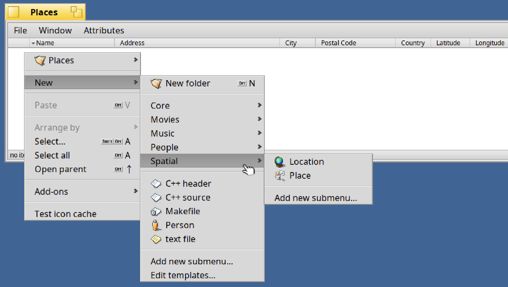
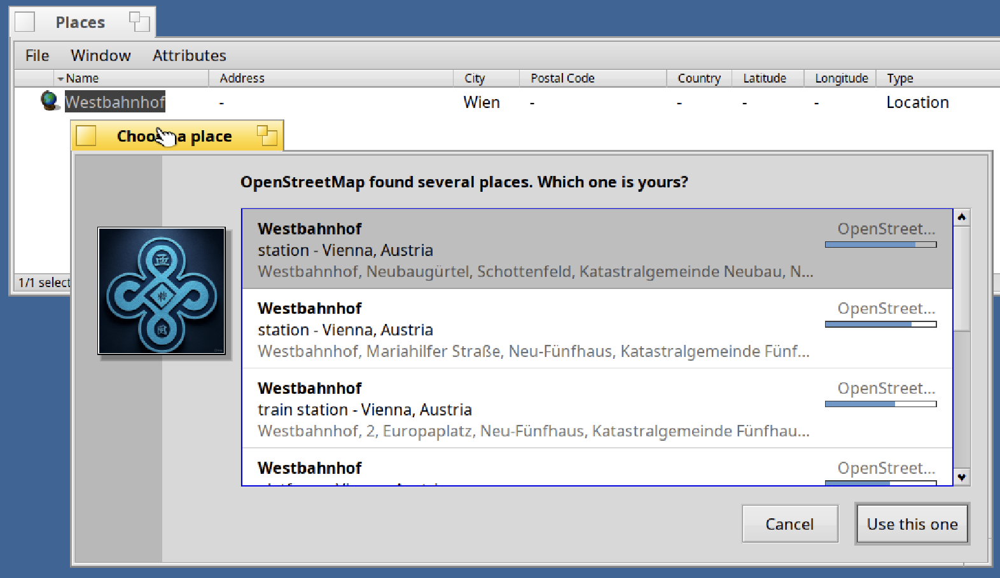
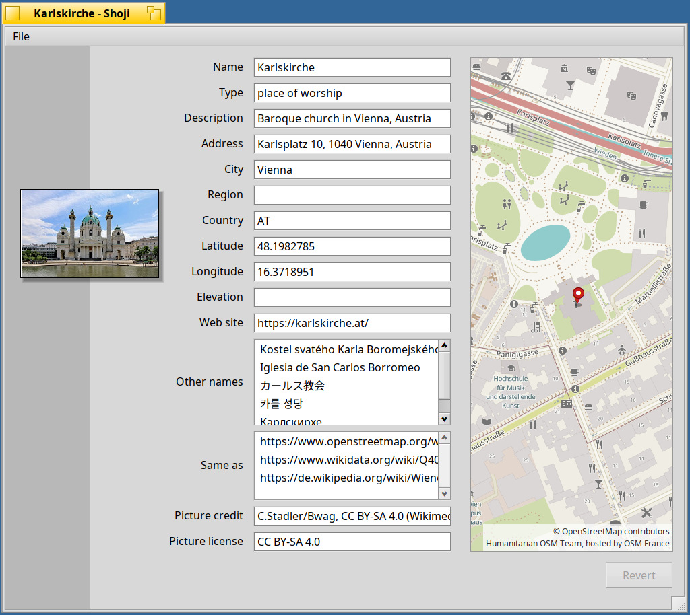
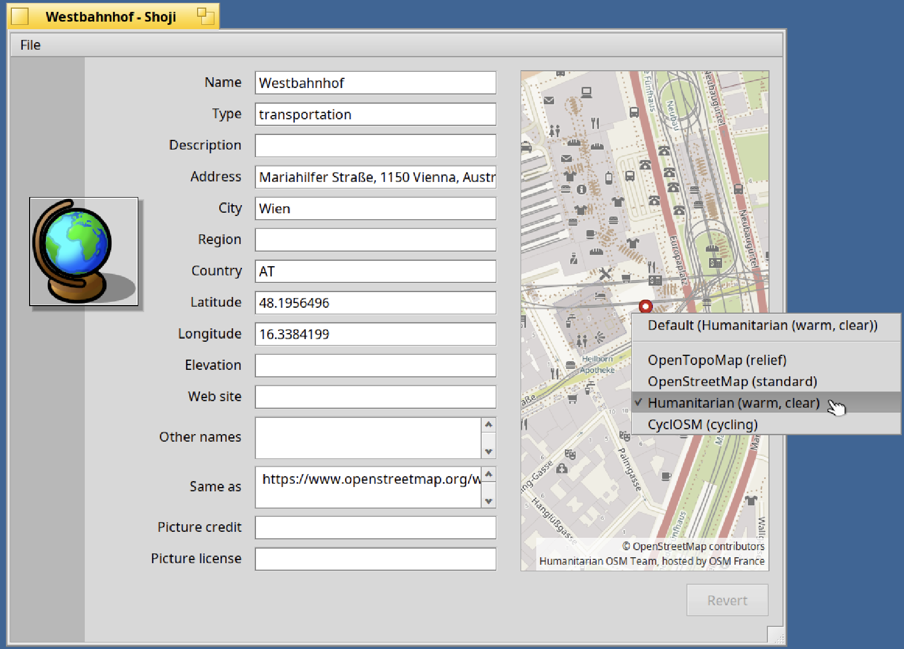
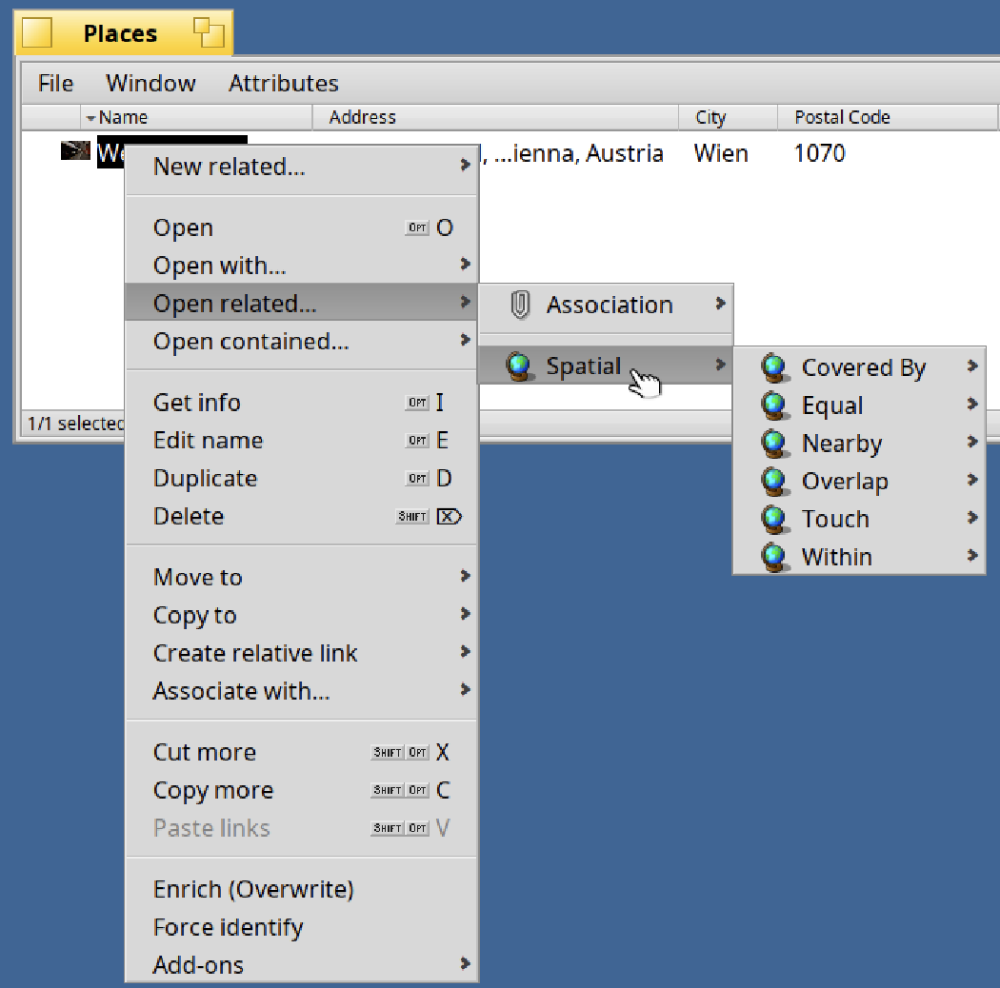
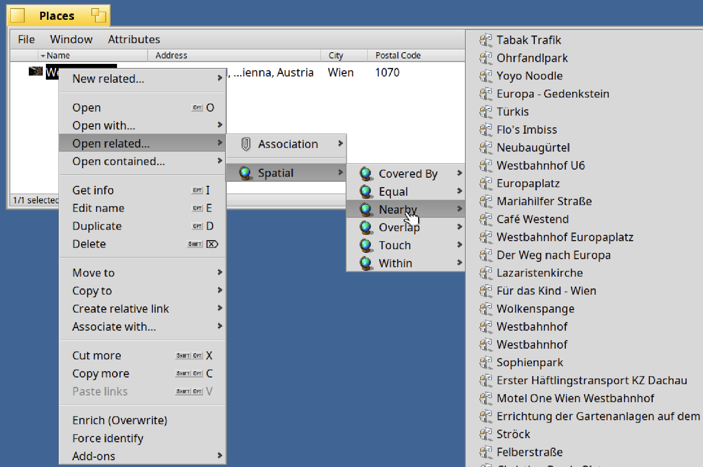
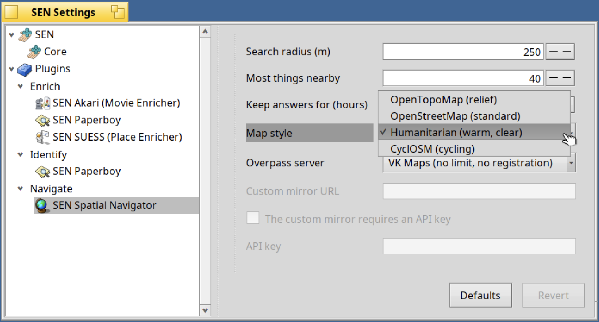
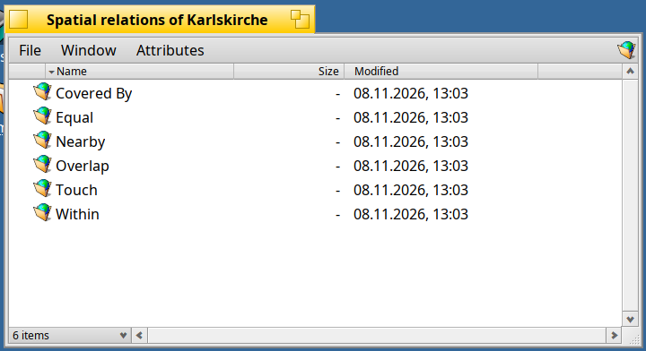
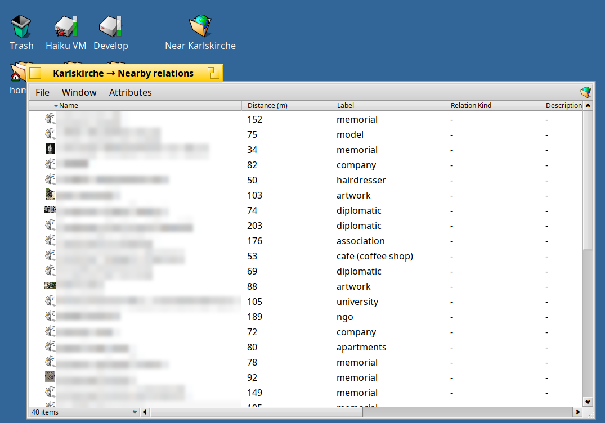

<!--
SPDX-License-Identifier: MIT
SPDX-FileCopyrightText: 2026 SEN Labs e.U.
-->

# SEN 1.0.0 Beta 6 "Sofia" — *Places and Spatial Relations*

> Everything happens somewhere.

Beta 5 was about making SEN yours. Beta 6 adds the last ontology of the 1.0 line: **SEN Spatial**, for **places and locations** and the **relations between them**. A new enrichment plugin, **SUESS**, looks places up at OpenStreetMap and Wikidata and gives them a picture; a **spatial navigator** works out what is *within* what, what *touches* what, and what is **nearby**; **Shoji** shows a place with a **map**; and **Akita** opens the relations of a whole group at once, as folders that fill when you open them.

**SEN (Semantic Extensions Native)** runs on **Haiku R1/beta6 nightlies (x86_64), from hrev60299 on**. If you have beta 5 installed, `pkgman update` brings you here (see *Upgrading from Beta 5* below).

> [!IMPORTANT]
> **SEN follows the Haiku nightlies**: packages for Akita and SEN FileTypes require `haiku >= r1~beta6_hrev60299_1` and set no upper version limit. An automated ABI check (`abi-check.sh` in the [akita](https://github.com/sen-laboratories/akita) repository) verifies compatibility against every new nightly.

## Places and locations

A **Place** is something with a name and an identity (*Karlskirche*, *Vienna*, *Café Central*); a **Location** is only where something is (the position of a photo, a meeting point). Both are in the **New › Spatial** menu of Akita, with the same attributes (name, other names, kind, position, bounding box, outline, address, links, picture), so one column or query works for both. They use the vocabularies of `schema.org`, Dublin Core and GeoSPARQL, and are stored, like everything in SEN, in the attributes of the file.



## SUESS, the place enricher

Choose **Enrich** on a Place or Location. **SUESS** (*Semantic Urban & Environmental Spaces for SEN*, a bow to the Viennese geologist Eduard Suess) searches [OpenStreetMap](https://www.openstreetmap.org) (Nominatim) by name, address or position and writes what it finds: other names, the kind of place, position, bounding box, a simplified outline, address, links (OpenStreetMap, Wikidata, Wikipedia) and a short description. If Wikidata has the place, it adds a **picture** — a photo or coat of arms — with its license and credit.



* **It searches where you say.** A file that names a city, region or country is looked up in that country only: *Westbahnhof* in *Wien* never offers the one in Budapest. A position, if the file has one, ranks the answers (and is **not sent**).
* **A metro station is told from a train station** of the same name: the chooser shows the kind, the line (*U6*) and who runs it (*Wiener Linien*).
* **Your position stays yours.** The GPS position of a *photo* is looked up only if you switch on *Use GPS location for lookup*.
* **No key, good manners.** At most one request a second, every answer kept for a week, an identifying User-Agent, as the public services ask.

> Data © OpenStreetMap contributors (ODbL). Descriptions from Wikidata (CC0); pictures from Wikimedia Commons, each under its own license (written to the file with the credit).

## Places in Shoji, with a map



Shoji shows a Place or Location as a form with a **map** beside it: the tiles around the place, zoomed to its bounding box, with a pin. Tiles come from public servers that need **no key**, are kept for two weeks and are asked for only when the map is shown. Choose the **style** with the secondary mouse button on the map:



* **OpenTopoMap** (relief), **OpenStreetMap** (standard), **Humanitarian** (warm and clear) and **CyclOSM** (cycling). The style is credited on the map as its license asks; if its server does not answer, a standard tile stands in.
* **The default** is a setting (*Settings › Plugins › Navigate › SEN Spatial Navigator › Map style*); the menu of a view only overrides it for Shoji, and its first item returns to the default.

## Spatial relations

The new group **Spatial** is in *Open related…*:



* **Within / Contains, Covered by / Covers, Touch, Overlap, Equal** are the relations between regions of the *Region Connection Calculus* (RCC-8), in the words of everyday use. They are **not stored**: the **spatial navigator** works them out when you open them, comparing the outlines of the places you have (with the geometry engine GEOS), and for *within* it follows Wikidata's "located in" chain up to the country (the *Stephansdom* is in *Innere Stadt*, *Vienna* and *Austria*; a place of the chain that you do not have yet is made in the Library, ready to enrich). They are never out of date after you correct an outline. Each says its **Kind** in words and carries a hidden **RCC-8** code for programs, and its **provenance** says whether the plugin or Wikidata said it.
* **Nearby** lists the named things that OpenStreetMap knows around a place — shops, cafés, sights, stops, parks — each with what it is (*cafe*, *place of worship*) and its **distance in metres**, notable ones before shops, things that are closed or abandoned left out. Each is a Place in the Library; the first dozen with a Wikidata item are enriched in the background, with pictures. It asks the **Overpass API**: you can choose a public mirror (or your own) in the settings, together with the search radius, the most things to list and how long answers are kept (24 hours by default, as OpenStreetMap is updated).
* **Located near** is stored: SUESS makes it for a Location or photo that it looked up.





## Akita: relation groups as folders

*Open related › Spatial* (the group itself) opens a window with a **folder for each relation** of the group — *Covered By*, *Nearby*, *Within*… — with a **globe-in-a-folder** icon:



* **They fill when you open them.** A relation that a plugin works out (and may ask a web service for) is **remote**: its folder is empty until you open it, then it says *Fetching relations…* and fills when the answer is in; opened again after five minutes it asks again. Nothing is asked that you do not look at. The same holds for the folder of *All relations*.
* **Keep what you like.** Drag such a folder to your Home folder or the Desktop: the copy keeps the attributes that say where it came from and **fetches again when you open it**, so a "nearby" folder of a place stays useful.



* **The menu does not make you wait.** The menu of the targets of a relation opens at once with a spinner (*Fetching relations…*) and the items follow.
* **Same names, told apart.** Targets with the same name in a folder are told apart by the names of their files, not by a number.
* **Relation folders show the icon of their relation** (`SEN:ICON:FOLDER`), as the ontology defines it. A file that is removed while a folder is read is no longer a crash.
* **New from a template** no longer takes over the installer's mark from the template file.

## Under the hood

* **Dynamic relations in the server.** Every plugin has its own channel (a looper and a queue), so a slow service does not hold up the others. A relation type that is *dynamic* is resolved by its **navigator plugin** (`kResolve`), which is given the Library folders; only a plugin that names the type is asked, for at most 90 seconds. Nine tests with a stub navigator check it.
* **The Library folders of a context have their own icon** (*Library Folder* by Matthew McClintock, Design Science License).
* **The SEN menu** in the Deskbar has *Restart SEN Server* and *Restart Akita* after *Settings…*.
* **The ontology installer** takes out the MIME types that a new version of an ontology no longer ships, with their templates (files of such a type keep it: nothing is changed on your files), and corrects a template that has the wrong type. This is how the relation *point of interest* of the first drafts of SEN Spatial went away.
* **API additions (sento):** the flag `SEN:remote` and the property `SEN:REL:Rcc8` for relation types, `SenSocketHttp.h` (the HTTP client over a socket, with timeouts and an `Authorization` header that is never sent to another host after a redirect) shared by the plugins and Shoji, `SenMapStyles.h` (the map styles), the plugin messages `kResolve` and `kLibraries`, `kConfigOnly` (the config of a relation type, answered at once), and for settings forms `enabled_when` (with `&` and `|`) and `-` as a separator line in a choice.
* **Ontology `0.1.0-38` (spatial)**; core and people `-33`, the others `-32`.
* **Akari, BERT and Paperboy** use the shared HTTP client (and read Wikimedia over a socket).
* The `.DS_Store` and other macOS leftovers are never committed in any repository.

## Packages

32 packages in the repository **Kiri**, among them:

* `sen_core`: `1.0.0~beta6-3`, `sen_oni`: `1.0.0~beta6-2`, `akita`: `1.0.0~beta6-13`, `shoji`: `1.0.0~beta6-7` (`sen_filetypes` remains at `1.0.0~beta4-1`).
* **New:** `sen_ontology_spatial` (`0.1.0-38`), `sen_plugin_place_enricher` (SUESS, `0.1.0~beta6-5`), `sen_plugin_spatial_navigator` (`0.1.0~beta6-13`; needs the HaikuPorts package `geos`). The other ontology packages are `0.1.0-32`, core and people `-33`.
* **Updated plugins:** Akari, BERT and Paperboy `~beta6-1`; the others stay at `~beta5`, all bundled under `sen_plugins` (`1.0.0~beta6-1`).

## Upgrading from Beta 5

Stop SEN while packages are updated, then restart the services:

```sh
sen stop
pkgman update
sen start       # and, to reload Akita:  akita restart
```

SEN Spatial is an ontology like the others: install it with `pkgman install sen_ontology_spatial sen_plugin_place_enricher sen_plugin_spatial_navigator` (or `sen_plugins`, which brings the plugins). The ontologies are installed on the first start (a notification says when it is done).

First-time installation? `pkgman add-repo https://kiri.sen-labs.org/x86_64`, then `pkgman install sen_core sen_plugins akita sen_filetypes shoji` along with the ontologies you like.

## Known limitations

* **A Location with a name only is searched worldwide.** *Westbahnhof* without a city, region or country gets the best-known one first, which can be in another country; give the city or country (a field of the file) and SUESS searches there only. A service that knows where you are is planned for the next beta.
* **Enrich (Overwrite)** reads the OpenStreetMap object that the file already links to again, it does not search anew; to look for another place, enrich a new Location.
* **Pictures:** places that Wikidata does not know (or whose item has no image) have none; OpenStreetMap has no pictures of its own.
* **Overpass can be slow.** The public server may need half a minute for a busy area (a larger area than 3 km across lists nothing: a district has thousands of named things). Choose a mirror in the settings if it is often busy.
* **Nearby shows what OpenStreetMap contributors have mapped**, including the names of small businesses; SEN stores it only in files on your own disk.
* **BFS volumes only.** Requires Haiku nightlies `hrev60299_1` or newer. Still a beta.

## What comes next

Beta 6 is probably the last beta before the release candidates of SEN 1.0: bug fixes and your feedback. Planned for the next beta: a location service that knows where you are (so that a name alone finds the place nearby first), GPX and GeoJSON extractors, and the positions of photos. In parallel, development continues on SEN 2.0 "Gnosis".

## Credits

Map data © [OpenStreetMap contributors](https://www.openstreetmap.org/copyright) (ODbL). Map styles: [OpenTopoMap](https://opentopomap.org) (CC-BY-SA), the Humanitarian OpenStreetMap Team style hosted by OpenStreetMap France, [CyclOSM](https://www.cyclosm.org). Descriptions from [Wikidata](https://www.wikidata.org) (CC0); pictures from [Wikimedia Commons](https://commons.wikimedia.org) under their own licenses. Icons: *Haikunaut* by Arti and *GCompris* by 3dEyes (MIT, [HVIF Store](https://hvif-store.art/)); *Library Folder* by Matthew McClintock (Design Science License). Geometry by [GEOS](https://libgeos.org).

## Your support is essential

Please consider clicking the "Support" button in the About dialog to contribute to ongoing development, or donate directly through [SEN Labs Liberapay](https://liberapay.com/sen-labs/).

## Feedback & Community

* **Issue Tracker & Source:** [https://github.com/sen-laboratories](https://github.com/sen-laboratories)
* **Package Repository:** `https://kiri.sen-labs.org/x86_64`
* **Community Discussion:** Haiku Community Forums
