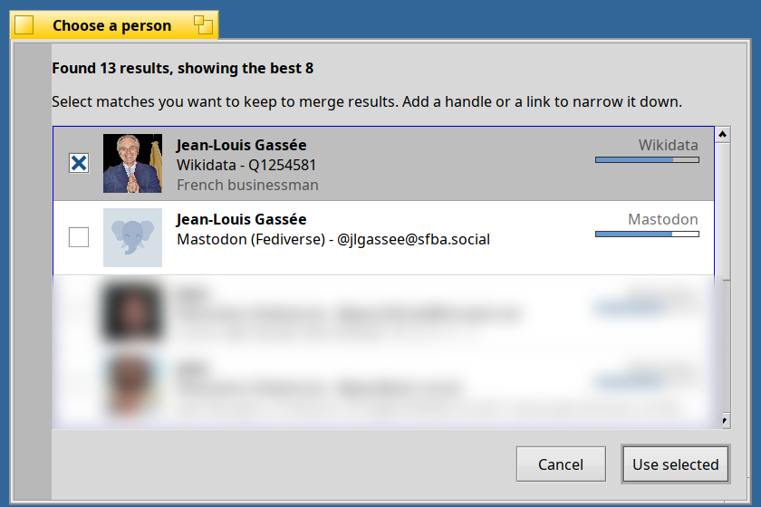
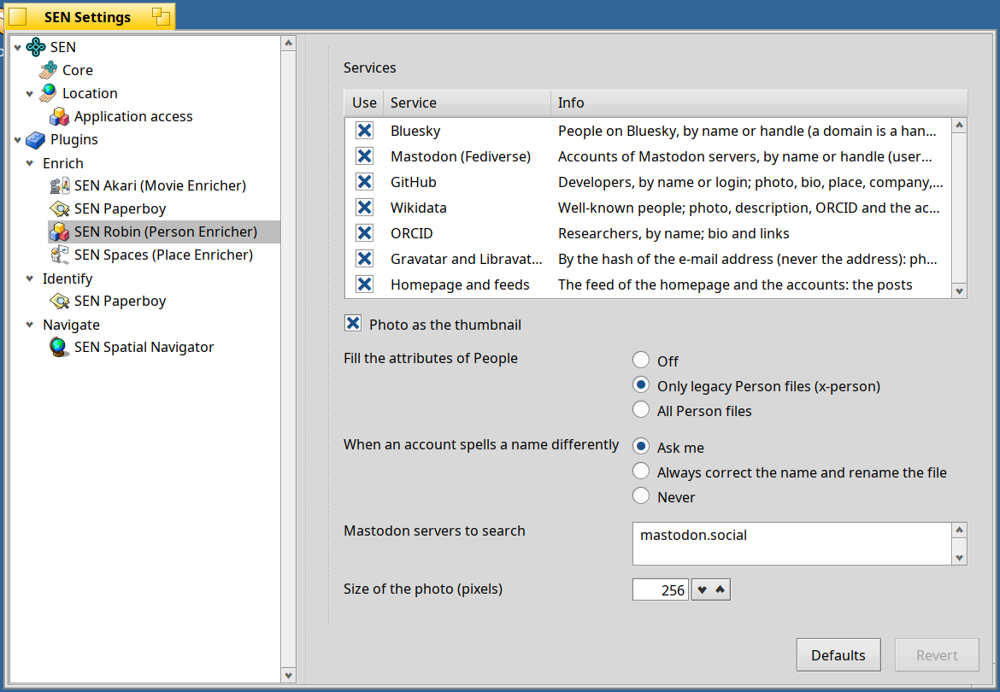
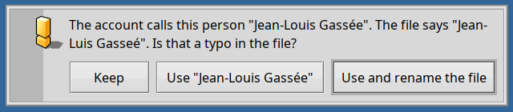
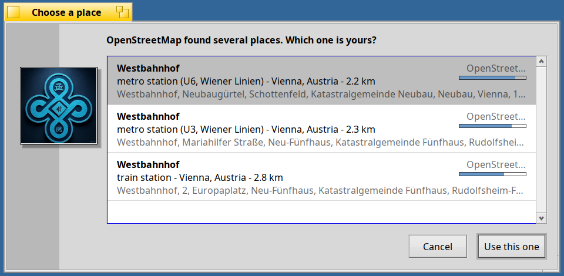
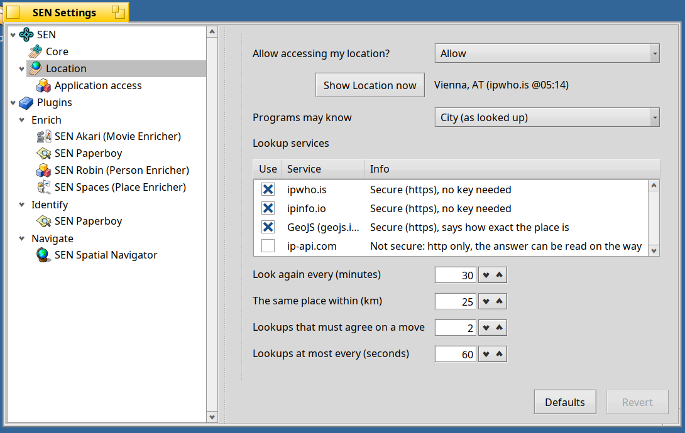
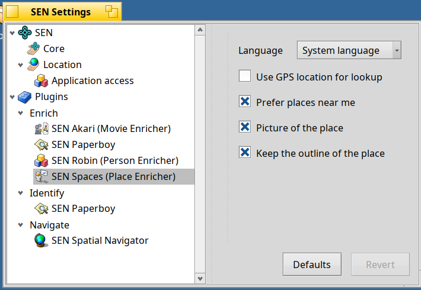
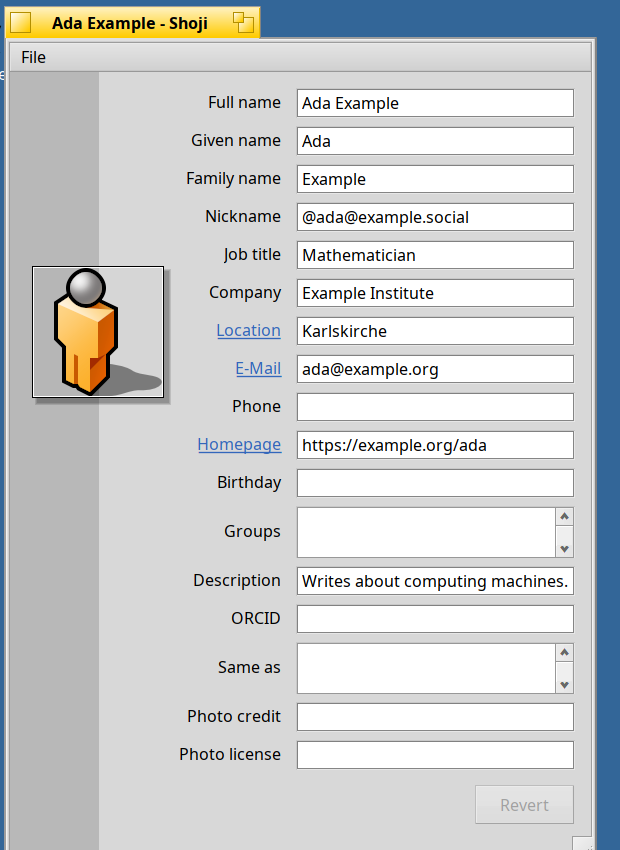
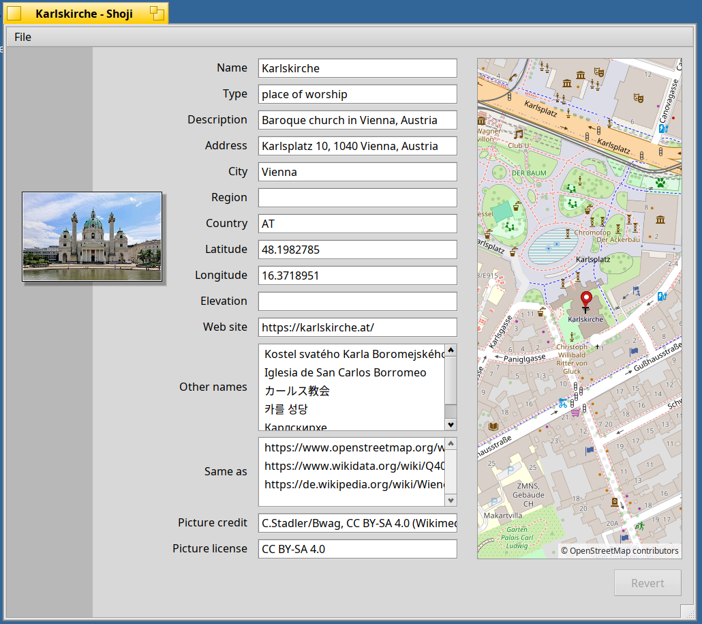
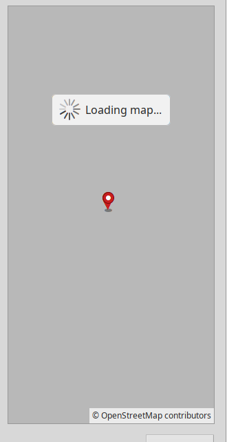
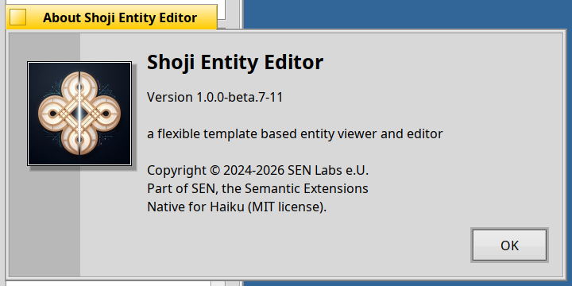

<!--
SPDX-License-Identifier: MIT
SPDX-FileCopyrightText: 2026 SEN Labs e.U.
-->

# SEN 1.0.0 Beta 7 "Sofia" — *People and Places*

> Know who. Know where.

Beta 6 brought places and spatial relations to SEN. Beta 7 connects those places to **people** and gives your desktop a privacy-first sense of **where you are**: a new enrichment plugin, **Robin**, builds rich person profiles and fetches recent posts from open web services; **Shoji** turns a person's contact details and location into interactive links that bridge directly to mapped places; and **Spaces** (formerly SUESS) teams up with the new **Basho** location service to prioritize places near you automatically.

**SEN (Semantic Extensions Native)** runs on **Haiku R1/beta6 nightlies (x86_64), from hrev60299 on**. If you have beta 6 installed, `pkgman update` brings you here (see *Upgrading from Beta 6* below).

> [!IMPORTANT]
> **SEN follows the Haiku nightlies**: packages for Akita and SEN FileTypes require `haiku >= r1~beta6_hrev60299_1` and set no upper version limit, so `pkgman` never holds your system back.



## Robin: enriching people across the open web

**Robin** is a new enrichment plugin for Person entities and legacy Haiku *People* contacts. Rather than scraping closed networks, Robin gathers public profile information—photos, biographies, roles, organizations, locations, verified links, and activity feeds—from open services where people publish their own profiles: **Bluesky, Mastodon (Fediverse), GitHub, Wikidata, ORCID, Gravatar/Libravatar**, and personal **homepages and RSS/Atom feeds**.

* **One priority list, under your control**: In *Settings › Plugins › Enrich › SEN Robin*, all supported services appear in a single reorderable table. Drag rows to set your preferred priority order and toggle individual sources on or off.
* **Direct lookups and smart discovery**: When a contact file already contains a profile link, handle, homepage, or e-mail address, Robin queries those accounts directly (e-mail addresses are hashed locally with SHA-256 for Gravatar/Libravatar and never sent in plain text). For enabled services where no account is recorded yet, Robin searches by name and presents matching candidates with photos and confidence scores.
* **Merge profiles across services**: Because one person often has profiles on multiple platforms—such as an ORCID academic record, a GitHub account, and a Mastodon profile—you can select several candidates at once in the *Choose a person* dialog. Robin merges their details in priority order without overwriting existing data on the file, picks the highest-resolution portrait across all sources, and saves the chosen profile links so future enrichments query those accounts directly.
* **Gentle name correction and Haiku People compatibility**: If an online profile spells a person's name slightly differently from your local file (such as fixing a typo or adding an accent), Robin offers to keep your version, adopt the profile's spelling, or update the name and rename the file to match. For compatibility with Haiku's native *People* app, Robin can also populate empty `META:name` and `META:nickname` attributes alongside SEN's standard semantic attributes.
* **Recent posts as a live relation**: When Robin discovers a person's RSS/Atom feed, Mastodon outbox, or Bluesky feed, it records their latest status on the file and enables the **Status** relation (*Open related… › Status*). Resolved on demand by the Personal Relation Navigator, this opens a folder of the person's recent posts as clean Markdown files, refreshed automatically when more than an hour old.





## Basho and Spaces: location awareness near you

In beta 6, searching for a place by name alone—such as *Westbahnhof* without a city or country—searched worldwide. Beta 7 introduces **Basho** (*place* in Japanese, and a nod to the wandering haiku poet Matsuo Bashō), an independent, privacy-first ambient location daemon for Haiku, and pairs it with **SEN Spaces** (the new name for the SUESS place enricher).

* **Local-first place lookups**: With Basho running, **Spaces** automatically biases unconstrained place searches toward your current region and ranks candidates by distance right in the chooser dialog. Only a coarse regional bounding box (tens of kilometres across)—never your exact position—is sent to OpenStreetMap.
* **Privacy by design**: Basho never connects to the network silently; it asks for permission before performing its first keyless IP geolocation lookup and caches fixes locally with anti-jitter filtering. In **Settings › SEN › Location**, you can test the current fix (*Show Location now*), reorder lookup providers, cap the maximum precision shared with apps (*city*, *region*, *country*, or a custom kilometre radius using grid-snapped coarsening that prevents triangulation), and manage per-application permissions in the **Application access** table. A companion `location` CLI tool provides full control from the Terminal, including manual coordinate overrides for offline or VPN use.
* **Smarter address and transit resolution**: When enriching a Place that has both a venue name and a street address, Spaces now queries them together. If OpenStreetMap only knows the street, the file keeps its venue title, adopts the street's coordinates and town, and lets you know. Transit lookups also filter out redundant platforms and stops so they no longer crowd the main station out of the candidate list.







## Shoji: connecting people to places

Shoji brings people and places closer together while expanding its form engine for richer system settings:

* **Interactive contact links**: In a Person window, **Homepage**, **E-Mail**, and **Location** now act as clickable links. Clicking a homepage opens your web browser, and clicking an e-mail address starts a message in your mail client.
* **One click from a person's location to a mapped place**: Clicking a person's **Location** field asks Spaces to resolve that place, creates a standalone Place entity in your Library, links the person to it, and opens the newly created place—complete with its interactive map—in its own window. Subsequent clicks open the linked place immediately.
* **Resilient, non-blocking maps**: Map views now display a clear *Loading map…* indicator while tiles arrive in the background, and slow or unreachable tile servers time out gracefully without freezing the window.
* **Unified Person form**: The Person view now includes dedicated fields for *Full name*, *Nickname* (unified across the ontology, forms, and Haiku's People app), *Company*, *Location*, and *ORCID*.
* **Interactive tables in settings forms**: Shoji's replicant form host now supports full table views with drag-and-drop row reordering, checkboxes, inline pop-up menus, action buttons, and per-row activity spinners—powering the new Robin and Basho preference panes.







## Akita and the desktop

* **Natural opening for semantic entities**: Double-clicking an entity file in Akita now opens it with the application associated with its semantic type—so Person files open directly in Shoji without requiring manual file-type overrides.
* **Cleaner dynamic relation loading**: When opening dynamic or remote relation folders, Akita now shows a barber-pole indicator with *Resolving relations…* in the window's status bar rather than inserting a temporary placeholder item inside the folder.
* **Enrich automatically on demand**: A new shared setting in *Settings › Plugins › Enrich* automatically triggers enrichment when you open a dynamic relation (such as *Nearby* on an unpositioned place, or *Status* on an unenriched person) so results appear in one step.
* **Quick Library access & everyday polish**: The SEN Deskbar menu now features a **Library** submenu right below *Context* for jumping straight to your entity folders. About and Info dialogs display the exact package revision (such as `1.0.0-beta.7-7`), tooltips across all settings pages are more concise, and pressing Escape while editing a list or table cell cleanly cancels the edit without closing the window.



## Under the hood

* **sento**: Added `SenVersion.h` for package-aware version strings (`sen::VersionText`, `PackageRevision`), expanded `SenChoice.h` with multi-select checkboxes and reorderable rows (`ChoiceOptions`), and extended the settings form specification with `table`, `properties`, `radio`, and `button` controls plus `reorderable`, `readonly`, and `busy_field` attributes.
* **Ontologies**: Updated the People ontology (`0.1.0-36`) with feed URL (`foaf:weblog`), latest status text and timestamp (`foaf:status`, `SEN:statusDate`), the *Status* relation, *Nickname* (`foaf:nick`), company (`schema:worksFor`), home location (`schema:homeLocation`), and ORCID iD (`vivo:orcidId`). Updated the Spatial ontology (`0.1.0-41`) for SEN Spaces and globe folder icons.
* **Robin architecture**: Built around a portable C++ core with 285 unit test assertions covering RSS/Atom/ActivityPub/Bluesky feed parsing, identity scoring, and priority-ordered profile merging, backed by a single `services = …` configuration line in `robin.settings`.

## Packages

<!-- to be filled from Kiri at the release: sen_core, sen_oni, akita, shoji, basho, the plugins (Robin, Spaces, personal relation navigator, spatial navigator, Akari, Paperboy) -->

* **Core & UI**: `sen_core` (`1.0.0~beta7-7`), `akita` (`1.0.0~beta7-3`), `shoji` (`1.0.0~beta7-12`), `sen_oni` (`1.0.0~beta6-2`), `sen_filetypes` (`1.0.0~beta4-1`).
* **Location service (new)**: `basho` and `basho_devel` (`0.1.0~develop.1-6`).
* **Plugins (`sen_plugins` `1.0.0~beta7-1`)**: **New:** `sen_plugin_person_enricher` (Robin, `0.1.0~beta7-8`). **Updated:** `sen_plugin_place_enricher` (Spaces, `0.1.0~beta7-9`), `sen_plugin_personal_relation_navigator` (`0.1.0~beta7-1`), `sen_plugin_spatial_navigator` (`0.1.0~beta7-1`), `sen_plugin_movie_enricher` (Akari, `0.1.0~beta7-1`), and `sen_plugin_paperboy` (`0.1.0~beta7-1`).
* **Ontologies**: `sen_ontology_people` (`0.1.0-36`) and `sen_ontology_spatial` (`0.1.0-41`).

## Upgrading from Beta 6

Stop SEN while packages are updated, then restart the services:

```sh
sen stop
pkgman update
sen start       # and, to reload Akita:  akita restart
pkgman install basho sen_plugin_person_enricher
```
*(Alternatively, updating `sen_plugins` pulls in Robin automatically; `basho` is optional and enables local search bias in Spaces as well as the Location settings pane.)*

Updated ontologies are installed automatically on first start. Robin now reads its service order from a unified `services = …` entry in `robin.settings`; if you customized Robin's settings in an earlier build, review your service order in the Settings window.

First-time installation? See the *Quick Install* instructions in the beta 3 notes:
`pkgman add-repo https://kiri.sen-labs.org/x86_64`, then run `pkgman install sen_core sen_plugins akita sen_filetypes shoji basho` along with your preferred ontologies.

## Known limitations

* **Repeated candidate prompts for unlinked services**: If a service remains enabled in Robin's priority list and the person has no account on that service, enriching the file again will still search by name and show the candidate chooser when multiple people match. Choosing *Cancel* keeps all data gathered from known accounts, or you can disable services you do not need.
* **Name-only search on Wikidata and ORCID**: Wikidata and ORCID are queried by name during initial discovery; once their identifier or link is recorded in the file, they are not re-queried on subsequent enrichments.
* **Automatic mode with common names**: Running Robin with `--auto` selects the highest-scoring match automatically, which may pick the wrong profile for a common name; review the links added to the file when enriching unattended.
* **Opt-in network location**: Basho prompts for permission before querying public IP geolocation services; if declined or left uninstalled, Spaces continues to work exactly as in beta 6.
* **Filesystem requirements**: BFS volumes only. Requires Haiku nightlies `hrev60299_1` or newer.

## What comes next

<!-- to be written by the owner -->

## Your support is essential

Please consider clicking the "Support" button in the About dialog to contribute to ongoing development, or donate directly through [SEN Labs Liberapay](https://liberapay.com/sen-labs/).

## Feedback & Community

* **Issue Tracker & Source:** [https://github.com/sen-laboratories](https://github.com/sen-laboratories)
* **Package Repository:** `https://kiri.sen-labs.org/x86_64`
* **Community Discussion:** Haiku Community Forums
