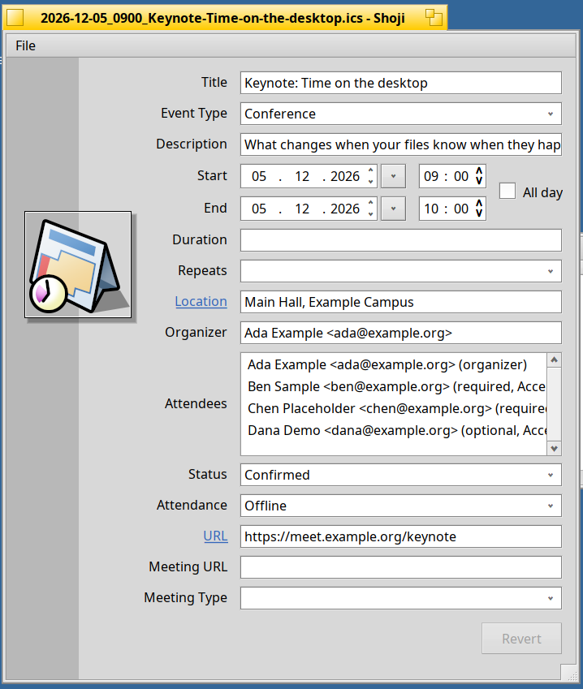
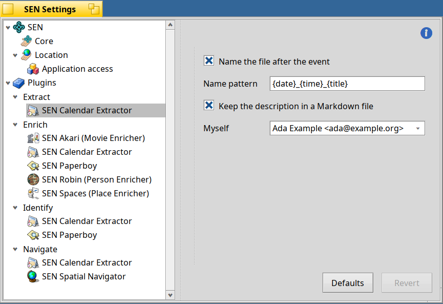
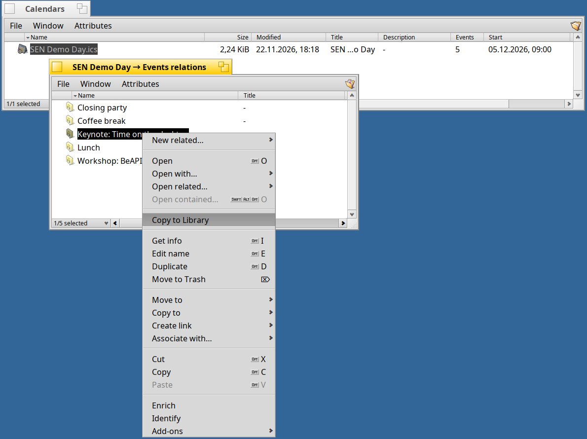
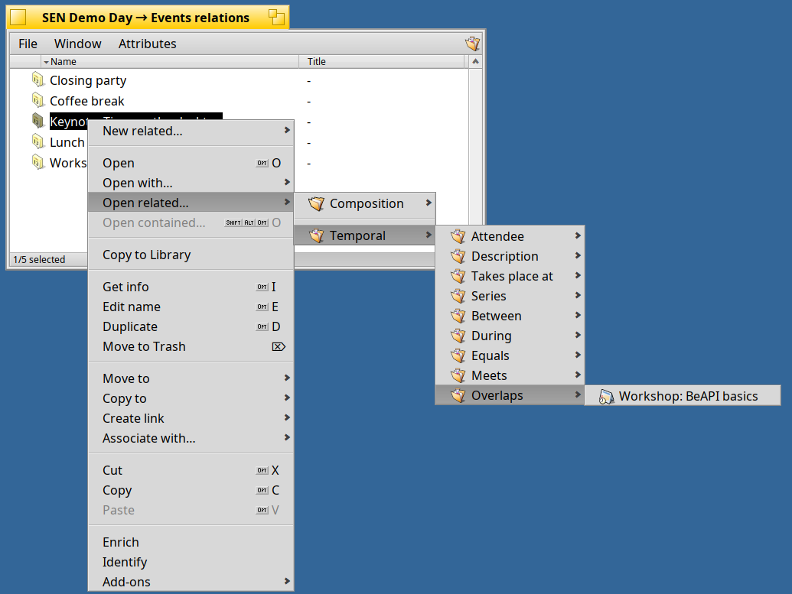
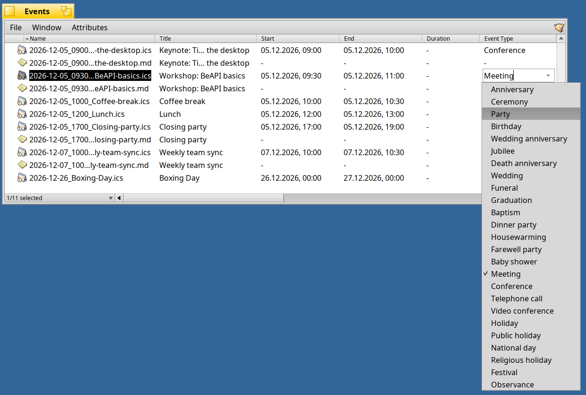
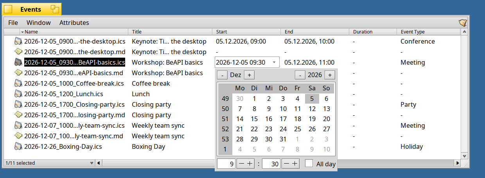
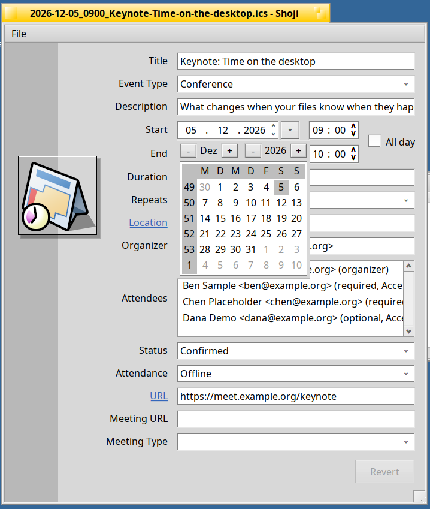

<!--
SPDX-License-Identifier: MIT
SPDX-FileCopyrightText: 2026 SEN Labs e.U.
-->

# SEN 1.0.0 Beta 8 "Sofia" — *Time and Events*

> Know when.

Beta 6 introduced places, and Beta 7 connected them to people with privacy-first ambient location awareness. Beta 8 completes the foundational triad with **time and events**: introducing the **Temporal ontology** (`Event` and `Calendar` entities), an offline **Calendar Extractor** for `.ics` and `.vcs` files, a dynamic **Temporal Navigator** powered by Allen's interval algebra, and comprehensive date/time controls in **Shoji**. 

At the same time, **Akita** receives a major productivity overhaul with spreadsheet-style in-place list editing, type-aware inline controls, its own native identity and vector branding, and seamless update detection. The **Spatial Navigator** now supports prioritized, testable Overpass API mirrors, and **Deskbar Contexts** can be created and activated in a single click.

**SEN (Semantic Extensions Native)** runs on **Haiku R1/beta6 nightlies (x86_64), from hrev60299 on**. If you have Beta 7 installed, run `pkgman update` to upgrade (see *Upgrading from Beta 7* below).

> [!IMPORTANT]
> **SEN follows Haiku nightlies**: packages for Akita and SEN FileTypes require `haiku >= r1~beta6_hrev60299_1` and define no upper version limit, ensuring `pkgman` never blocks system updates.



## The Temporal Ontology: Events and Calendars

The new **SEN Temporal** ontology brings first-class time and schedule management to Haiku:

* **Dual Exact and Fuzzy Time (EDTF)**: Timestamps (`schema:startDate` and `schema:endDate`) are stored natively as 64-bit integer file attributes, ensuring fast BFS indexing, native Tracker queries, and accurate column sorting across historical dates (including pre-1970 and post-2038). Approximate or uncertain dates (*"around May 1994"*, *"2020s"*) are captured alongside using the standard Extended Date/Time Format (EDTF, e.g. `1994-05~`, `202X`), with earliest and latest bounds resolved automatically. Any file on your system can carry start and end attributes.
* **Comprehensive Event Metadata**: An **Event** models title, description, start and end timestamps, duration, event type, physical location, organizer, attendees (with participation status), online meeting links, and recurrence rules. A **Calendar** acts as a container for events imported from calendar files.
* **Curated Event Types**: Contextual autocomplete suggests common event categories (Meeting, Birthday, Wedding, Conference, Funeral, etc.), newly expanded to include formal calendar categories: **Holiday, Public holiday, National day, Religious holiday, Festival**, and **Observance**—all mapped to Wikidata entities while allowing arbitrary custom text.
* **Native HVIF Vector Icons**: Events and Calendars feature dedicated vector artwork ("Calendar" by Matthew McClintock under the Design Science License and the calendar icon by zuMi; notices and licenses ship with the package).

## The Calendar Extractor

Select any calendar file (`.ics`, or legacy `.vcs` from Google Calendar, Outlook, Apple Calendar, Thunderbird, or Nextcloud) in Akita and choose **Enrich**:

* **Resilient, 100% Offline Parsing**: Built with a standalone C++ parser backed by over 230 tests. It gracefully handles folded lines, UTF byte order marks, quoted-printable encoding, legacy vCalendar 1.0 syntax, timezones, and complex recurrence patterns (daily, weekly, monthly, yearly, intervals, counts, and exceptions like "second Tuesday of the month") completely locally without network access.
* **Entities and Organization**: Single events become enriched **Event** files; files containing multiple events become **Calendar** containers. Files are automatically renamed using customizable patterns (e.g. `{date}_{time}_{title}.ics`), and detailed descriptions are saved as companion **Markdown files** (`.md`) preserving hyperlinks and notes.
* **Deep Relationship Mapping**:
  * **Attendees**: Linked to `Person` entities in your Library by email address, recording attendee roles and participation responses. You can designate your own identity via the *Myself* setting.
  * **Takes place at**: Linked to physical `Place` entities in your Library.
  * **Online Meetings**: Automatically extracts direct join links and detects platforms (Zoom, Google Meet, Microsoft Teams, Webex, Jitsi, GoToMeeting, Whereby, and Skype).
  * **Series**: Automatically links previous and next occurrences calculated from recurrence rules, including exceptions.
* **Entity Materialisation**: Choosing *Copy to Library* on an item in a calendar's *Events* relation (or dragging it into a folder) extracts it into an independent, fully enriched event file.
* **Attributes Before Content**: In accordance with SEN's updated plugin architecture, extracted attributes take precedence over the raw source file, leaving original files untouched.




## The Temporal Navigator

Open the relations of any file with a timestamp (*Open related… › Temporal*) to inspect its chronological relationships through **Allen's Interval Algebra** (W3C OWL-Time):

* **Dynamic Chronological Relations**: Evaluates **Between** (preceding and succeeding), **Meets**, **Overlaps**, **During**, and **Equals** (plus their inverses) on the fly across all mounted BFS volumes. Relations are computed dynamically on demand and never stored statically on disk.
* **Fuzzy Interval Safety**: When comparing imprecise dates, intervals evaluate across their widest possible temporal extent, preventing inaccurate or misleading relationships.
* **Universal Application**: Temporal relations work across all file types with a `schema:startDate`, connecting events, documents, photos, and media across time.



## Akita: Spreadsheet-Style List Editing & Desktop Polish

**Akita** receives a significant set of workflow and visual improvements:

* **Spreadsheet-Style In-Place Editing**: Clicking anywhere within an editable attribute cell in list view (even an empty cell) immediately highlights the cell and begins inline editing after a brief delay, allowing fast double-clicks to still open files. Pressing **Enter** commits changes; **Escape** cleanly reverts to the original value. The click area for file names remains tailored so rubberband selection continues to work effortlessly in adjacent whitespace.
* **Type-Aware Inline Controls**:
  * **Checkboxes**: Boolean attributes display responsive checkboxes with proper width and alignment, cleanly grayed out on read-only attributes or volumes.
  * **Date & Time Picker**: Date and time cells feature an integrated dropdown calendar button. Edit dates visually with day/month/year navigation, time-of-day selectors, and an "All day" toggle, or type directly (`2026-11-12 09:30`, `1994-05~`, `12 Nov 2026`). Non-date input is validated and rejected.
  * **Autocomplete Filter Popups**: Attributes with constrained value vocabularies (e.g. `Event Type`) present a live autocomplete dropdown (`SenFilterMenu`) as you type. Prefix matches appear first, followed by substring matches with matching characters highlighted in **bold**. A dedicated dropdown arrow allows browsing the complete vocabulary.
* **Visual Applicability (`n/a`)**: When a displayed attribute column does not apply to a file's semantic type (such as an `Event Type` column on a movie or plain document), Akita displays a dimmed **n/a** rather than an ambiguous empty cell. Non-applicable cells cannot be edited.
* **Native Akita Branding**:
  * The Deskbar process label now officially displays **Akita** (replacing the legacy Tracker string) with dedicated application metadata.
  * Introduces brand-new native vector HVIF icons: hand-crafted pixel icons for 16 and 32 px displays, and traced vector artwork for higher resolutions. Robin and the Oni installer receive matching updated icon designs.
* **Unified Column Formatting**: Date and time columns now enforce a consistent format across every row, eliminating mixed numeric and relative date presentations.
* **Seamless Update Notifications**: When `pkgman update` installs an updated Akita package, running Akita instances automatically detect the upgrade and display a prompt offering to restart the file manager immediately or wait until later.
* **Enhanced BFS Time Queries**: Find queries on date/time attributes now offer *before*, *after*, and *is* operators with an integrated calendar picker. Queries operate directly on indexed 64-bit timestamps, avoiding legacy text-parsing query bugs.
* **Direct Entity Navigation**: Double-clicking an event item within a calendar relation directly opens the event entity in Shoji. Dragging items from relation windows into folders materialises them as standalone files.





## Shoji: Forms, Dates, and Recurrence

* **Event Form**: Complete layout covering Title, Event Type, Description, Start and End times, Duration, Recurrence, Location, Organizer, Attendees, Status, Attendance, and Meeting Links. Location and meeting links can be launched directly with a single click.
* **Interactive Date & Time Control**: Displays dates matching your locale's preferred order and separators. Features a dropdown calendar, time-of-day input, and a unified **All day** toggle between start and end fields. Changes can be committed with **Enter**, by tabbing away, or via the calendar, while **Escape** reverts.
* **Logical Boundary Protection**: Start and end dates remain logically synchronized: setting an end time before the start automatically adjusts the start, while advancing the start time past the end moves the end forward.
* **Advanced Recurrence Editor**: Provides preset recurrence options (Daily, Weekdays, Weekly, Monthly, Yearly) along with a **Custom…** dialog to configure custom cycle intervals (every N days, weeks, months, or years), specific weekdays (starting on your locale's first day of the week), and end conditions (never, after N occurrences, or until a specific date). Human-readable phrases automatically sync with standard iCalendar `RRULE` strings (`SEN:recurrence`).
* **Semantic Type Navigation**: Clicking the semantic type badge in an entity form opens SEN FileTypes directly at that type's definition.
* **Dynamic Settings Architecture**: Settings forms gain autocomplete text popups, master/detail table bindings (`follows_table`), side-by-side controls, per-field revert buttons, and non-blocking button states ("Waiting for reply…").
* **Localization Ready**: All Shoji UI strings are cataloged and ready for translation via Haiku's Locale Kit (`locales/en.catkeys`).



## The Deskbar Menu: Context → New…

The SEN Deskbar menu now places **New…** at the very top of the **Context** submenu. Selecting it creates a new workspace context, immediately switches to it, and opens its folder in Akita with the name highlighted for instant renaming. Renaming your active context later preserves its active status seamlessly.

## Places: Multi-Server Overpass Support

The Spatial Navigator now supports a prioritized, configurable list of OpenStreetMap **Overpass API servers**:

* **Multi-Mirror Fallback**: Define and reorder a priority list of Overpass endpoints via drag and drop. If a primary mirror fails or times out, queries gracefully fall back to the next available server.
* **API Key Support**: Ships with pre-configured public servers enabled by default, with additional high-capacity servers (such as overpass.ch) ready to toggle on with a free API key. A convenient **Get key…** button opens provider registration pages directly.
* **Inline Connection Testing**: Test buttons next to each mirror display live HTTP status codes and response indicators.
* **Address Prioritization & Caching**: Spaces prioritizes existing city, region, and country attributes before query expansion, while map tile lookup failures are cached to avoid redundant network attempts.


## Under the Hood

* **sento Library**:
  * `SenEdtf.h`: Parser and evaluator for Extended Date/Time Format (EDTF) specifications, calculating earliest/latest bounds, durations, and local time resolution.
  * `SenTimeAttributes.h`: Unified management of exact 64-bit timestamps alongside companion fuzzy text values.
  * `SenAttrValues.h` & `SenFilterMenu.h`: Fast prefix and substring autocomplete popup engine (`sen::FilterPopUpMenu`).
  * `SenRecurrence.h` & `SenRepeatPicker.h`: Bidirectional translation between natural language recurrence descriptions and RFC 5545 recurrence rules.
  * Settings form enhancements: Added `popup`, `update_msg` master/detail bindings, `beside` layout support, revert actions, and `kActionDone` asynchronous button completions.
  * Indexing: Timestamps are indexed as native 64-bit integers (`sen::IndexTypeOf`), overcoming BFS `TIME` indexing constraints.
* **Ontologies**:
  * New `sen_ontology_temporal` (`0.1.0-12`) package.
  * Attribute enum vocabularies published directly into Haiku's MIME database (`SEN:ATTR:VALUES`).
  * Renamed the core *Contains* relation to **Composition** with inverse relation *contained in*. Its menu has a level for each direction (*Open related… › Composition › contains / contained in › …*), and its relation folder has a folder for each.
  * Exposed *Description* attribute as viewable across all entity ontologies.
* **sen-core**:
  * Relation and plugin dispatch now checks both technical MIME types and semantic entity types.
  * Added entity materialisation protocols (`kRelationsMaterialise`, `SEN:materialiseAs`).
  * Server-side provenance signing for ontology-provided relations.
  * Automatic session recovery and retransmission for restarted plugin settings.
* **sen_oni (Ontology Installer)**:
  * Eliminates redundant processing by skipping updates when schemas are unchanged.
  * Replaced `/dev/fd` process substitution with portable file reads, resolving a persistent pipe lockup on Haiku.
  * Batched notification delivery with dedicated Oni branding and reduced process forks.

## Packages

* **Core & UI**: `sen_core` (`1.0.0~beta8-13`), `akita` (`1.0.0~beta8-25`), `shoji` (`1.0.0~beta8-32`), `sen_oni` (`1.0.0~beta8-7`), `sen_filetypes` (`1.0.0~beta4-1`).
* **Location Service**: `basho` and `basho_devel` (`0.1.0~develop.1-7`).
* **Plugins (`sen_plugins` `1.0.0~beta8-2`)**:
  * **New**: `sen_plugin_calendar_extractor` (`0.1.0~beta8-8`), `sen_plugin_temporal_navigator` (`0.1.0~beta8-4`).
  * **Updated**: `sen_plugin_place_enricher` (Spaces, `0.1.0~beta8-1`), `sen_plugin_spatial_navigator` (`0.1.0~beta8-9`), `sen_plugin_person_enricher` (Robin, `0.1.0~beta7-12`).
* **Ontologies**:
  * **New**: `sen_ontology_temporal` (`0.1.0-12`).
  * **Updated**: `sen_ontology_core` (`0.1.0-35`), `sen_ontology_people` (`0.1.0-38`), `sen_ontology_spatial` (`0.1.0-42`), `sen_ontology_movies` and `sen_ontology_papers` (`0.1.0-34`), `sen_ontology_books` (`0.1.0-33`).

## Upgrading from Beta 7

Stop SEN services before updating packages, then restart them:

```sh
sen stop
pkgman update
sen start       # Akita will prompt to restart automatically if running
pkgman install sen_plugin_calendar_extractor sen_plugin_temporal_navigator sen_ontology_temporal
```
*(Updating `sen_plugins` pulls in the calendar extractor and temporal navigator automatically.)*

Updated ontologies install automatically upon startup. Events enriched under earlier development builds remain fully compatible; re-enriching them updates file naming, extracts companion Markdown descriptions, and links relational metadata.

First-time installation? Follow the *Quick Install* instructions from the Beta 3 release notes:
`pkgman add-repo https://kiri.sen-labs.org/x86_64`, then run:
`pkgman install sen_core sen_plugins akita sen_filetypes shoji basho` along with your desired ontologies.

## Known Limitations

* **Fuzzy Time Entry**: Date and time picker controls are tailored for exact timestamps. Fuzzy or approximate dates (`1994-05~`, `202X`) are edited as text fields when present.
* **Unrecognized Recurrence Rules**: Unrecognized or non-standard RFC recurrence patterns will log a notice and omit the *Series* relation. Unparsed custom strings in the *Repeats* field will be preserved without altering the underlying rule.
* **Entity Materialisation**: Dragging relation items creates entities when dropped into filesystem folders, *Copy to Library*, or *Copy to…*; dragging into relation browser windows or Trash is not supported.
* **Overpass API Keys**: Public servers may experience latency during peak periods. Servers requiring API keys remain dormant until a valid key is entered in settings.
* **Filesystem**: Requires BFS volumes and Haiku nightlies `hrev60299_1` or newer.

## What's Next

* **Required Form Validation**: Form engine support for mandatory fields and settings confirmation dialogs before exiting incomplete configurations.
* **Academic Paper Citations & Authors**: Dynamic relations connecting papers to citations, references, authors, institutions, and topics with one-click *Add to Library* materialisation.
* **Bidirectional Calendar Synchronization**: Background transports to synchronize local calendar files with remote providers such as Google Calendar, CalDAV, and Nextcloud.
* **Localization**: Initial German (`de`) localization catalogs for Akita and Shoji.

## Support the Project

If you appreciate native semantic computing on Haiku, please consider clicking the "Support" button in the About dialog or contributing directly via [SEN Labs Liberapay](https://liberapay.com/sen-labs/).

## Feedback & Community

Discussions, bug reports, and suggestions are welcome on the [Haiku Community Forum](https://discuss.haiku-os.org/) and the [SEN project repository](https://github.com/sen-laboratories).
