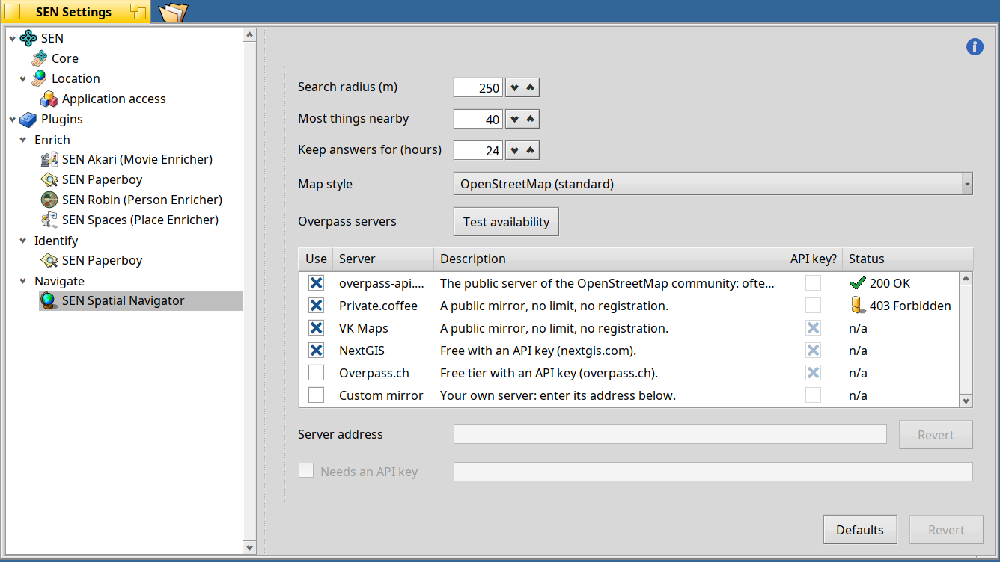

<!--
SPDX-License-Identifier: MIT
SPDX-FileCopyrightText: 2026 SEN Labs e.U.
-->

# SEN 1.0.0 Beta 8 "Sofia" — *Time and Events*

> Know when.

Beta 6 brought places, beta 7 brought people and your own whereabouts. Beta 8 completes the picture with **time**: a new **Temporal** ontology with **Events** and **Calendars**, a **calendar extractor** that turns `.ics` and `.vcs` files into events, a **temporal navigator** that shows how events lie in time to each other, and date and time controls in **Shoji**. **Akita** gets a much better way to edit attributes in the list, and the spatial navigator can use a list of **Overpass servers**.

**SEN (Semantic Extensions Native)** runs on **Haiku R1/beta6 nightlies (x86_64), from hrev60299 on**. If you have beta 7 installed, `pkgman update` brings you here (see *Upgrading from Beta 7* below).

> [!IMPORTANT]
> **SEN follows the Haiku nightlies**: packages for Akita and SEN FileTypes require `haiku >= r1~beta6_hrev60299_1` and set no upper version limit, so `pkgman` never holds your system back.

<!-- screenshot: images/beta8/shoji-event.png — an event in Shoji (Event Type list, Start and End controls, attendees, links) -->

## The Temporal ontology: Events and Calendars

**SEN Temporal** is the new ontology for everything that has a time. An **Event** has a title, a description, a **start**, an **end**, a duration, a **type**, a place, an organizer, attendees, a status, the link of an online meeting and how it repeats. A **Calendar** is the umbrella of the events of one calendar file.

* **Exact and fuzzy times**: A time is stored as a real time attribute (`schema:startDate` is the earliest moment, `schema:endDate` the latest), so that columns, sorting and queries work as they do for any time. A time that is not exact (*about May 1994*, *some year of the 2020s*) is written in the Extended Date/Time Format (EDTF, `1994-05~`, `202X`) and kept as text beside the time; any file may carry a start and an end, not only events.
* **Event types**: The type of an event (*Meeting, Birthday, Wedding, Conference, Funeral...*) is offered from a list that follows what you type. New in this revision are the days of the calendar: **Holiday, Public holiday, National day, Religious holiday, Festival** and **Observance**. Every type is mapped to Wikidata; any other text is allowed too.
* **Icons**: Events and Calendars have their own icons ("Calendar" by Matthew McClintock under the Design Science License, and the one by zuMi; the notices ship with the package).

## The calendar extractor

Select a calendar file (`.ics`, also the old `.vcs`; exported from Google, Outlook, Apple, Thunderbird and others) in Akita and choose **Enrich**:

* **A forgiving reader** of iCalendar and vCalendar 1.0: folded lines, byte order marks, quoted-printable, old recurrence rules, broken or unclosed components are handled, and the common recurrence rules (daily to yearly, intervals, counts, exceptions, "the second Tuesday") are understood. Nothing is sent over the network.
* **A file becomes an Event** with its times, place, organizer, status, attendees, repeat rule in words and the link of an online meeting together with its service (Zoom, Google Meet, Microsoft Teams, Webex, Jitsi, GoToMeeting, Whereby, Skype). A file with several events becomes a **Calendar**.
* **Named after the event**: `2026-11-12_0930_Planning.ics`, by a pattern that you can change (`{date} {time} {year} {month} {day} {hour} {minute} {title}`); the description becomes a **Markdown file** beside it with its links and formatting.
* **Relations**: **Attendee** (the people with their role and their response; each a Person in the Library, found by the e-mail address; you are marked with the setting *Myself*), **Takes place at** (a Place), **Series** (the instance before and after, from the repeat rule, with exceptions) and **Description**. At a calendar, **Events** lists the events it holds, in order of time.
* **Keep an event as an event**: *Copy to Library* on an item of the Events relation (or dragging it out of the window, or *Copy to*) makes a calendar file of its own, enriched like one you received alone; keeping it again finds the file that is there.

<!-- screenshot: images/beta8/calendar-extractor-settings.png — the settings of the calendar extractor (name pattern, Myself, description) -->
<!-- screenshot: images/beta8/events-relation.png — the Events relation of a calendar and Copy to Library -->

## The temporal navigator

Open the relations of an event (*Open related*, group **Temporal**) to see how it lies in time to the others: **Between** (what is before and after), **Meets**, **Overlaps**, **During** and **Equals**, the relations of **Allen's interval algebra** (the names of W3C OWL-Time), with their inverses, worked out when you open them, never stored. Two days in a row *meet*; a time that is not exact counts with its widest extent, so a relation is never claimed that the time does not allow. Any file that has a start is found, whatever its type; the query goes over all volumes.

<!-- screenshot: images/beta8/temporal-relations.png — Open related, group Temporal, at an event -->

## Shoji: days, times and events

* **Event form**: title, type, description, start, end, duration, repeats, place, organizer, attendees, status, attendance and links. The label of the place and of the links opens them (a click on the place asks Spaces to look it up).
* **Date and time control**: the day in the order and with the separator of your locale (typed as it is written, or picked from a calendar that drops down), the time of day, and **All day**. Typing is a pending change that **Enter**, leaving the control, picking a day or *All day* completes, and that **Escape** puts back; the same holds for every field.
* **The end is never before the start**: an end typed before the start becomes the start; a start moved past the end takes the end with it.
* **Birthdays and other days** (a day that may be missing) get the date control, too.
* **Lists of common values** (the event type, for one) follow the text field instead of a button, see *Akita* below.
* **The semantic type opens FileTypes**: the label of the type in a form opens SEN FileTypes (or Haiku's) at that type. MIME string attributes are shown as text.
* **Settings forms** gain the **popup** kind (a text field with a list that follows the text), details that follow the **selected row of a table** (master and detail) with *Revert* buttons, fields beside another, and a button that is greyed while it waits for its answer (*Waiting for reply...*).

<!-- screenshot: images/beta8/shoji-datetime.png — the date and time control with its calendar -->

## Akita

* **Click to edit, done right**: in the list view the **whole cell** of an editable attribute is the place to click (an empty one too), as in a spreadsheet. The cell is **outlined at once**, the edit starts after a short pause (a faster double click still opens the file) and fills the cell. **Enter** accepts, **Escape** reverts; the name keeps its small area so that the space after it still starts a rubber band selection.
* **Lists of values while you edit**: attributes with a list of values (the event type) show a list below the field that follows the text: first the values that **begin** with it, else those that **contain** it, the matching characters in **bold**; a small arrow at the right end opens the whole list.
* **Akita offers a restart after an update**: when `pkgman update` has installed a new Akita, a running Akita notices it and asks *Later* or *Restart*.
* **Relations**: *Copy to Library* and *Open related* on the items of a relation that are entities; dropping them into a folder makes the entities there. The relations of a type show the **icon of their folder** (spatial, temporal and document references have their own); a relation item that has a title of its own (an event of a calendar) is named by it; *Open contained* is greyed out where there is nothing contained.
* A file that says that relations could not be fetched has the icon of a **broken link**.

<!-- screenshot: images/beta8/akita-edit-cell.png — the outlined cell and the list of event types in the list view -->

## Places: the Overpass servers

The spatial navigator asks a **list of Overpass servers** in turn (a switch, a name, a description and the order for each; drag a row to move it): the public server and two more that need no key are on at first, two more that need a free key are off. A server that fails is not waited for, each server has a **Test** that shows the HTTP status, an **API key** and an address that you may change, and *Spaces* now puts the city, region and country that a file says before the name that it was found by. Map tiles that a style's server does not have are remembered, so the standard tile is not fetched again.



## Under the hood

* **sento**: `SenEdtf.h` (EDTF: earliest and latest moment, durations; times of day as local time on request) and `SenTimeAttributes.h` (the one implementation of start, end and the text beside them), `SenAttrValues.h` (the allowed values of an attribute, from the MIME database) and `SenFilterMenu.h` (`sen::FilterPopUpMenu`, the list that follows a text field); the settings form specification gains `popup`, master/detail (`update_msg`), `beside`, revert buttons and `kActionDone`. BFS cannot index a time attribute as a time: it is indexed as the 64-bit integer that holds it (`sen::IndexTypeOf`), which the server and the ontology installer now do.
* **Ontologies**: `sen_ontology_temporal` (new, `0.1.0-10`), enum values of attributes are published in the MIME database (`SEN:ATTR:VALUES`), *Description* is viewable in all ontologies, the core relation *Contains* is called **Composition**, Locations have the fields of their form.
* **sen-core**: relations and plugins are looked up by the technical **and** the semantic type of a file; items of a relation can be made into entities (*materialise*, `SEN:materialiseAs`); a one-sided relation type is only offered for a file that has it; the settings of a plugin that ended its session are sent again after it restarted.
* **Calendar extractor**: a portable C++ core with more than 230 test checks (time arithmetic, parser, calendars, texts, facts); the temporal navigator has 75 checks.

## Packages

<!-- to be checked against Kiri at the release -->

* **Core & UI**: `sen_core` (`1.0.0~beta8-6`), `akita` (`1.0.0~beta8-14`), `shoji` (`1.0.0~beta8-26`), `sen_oni` (`1.0.0~beta8-2`), `sen_filetypes` (`1.0.0~beta4-1`).
* **Location service**: `basho` and `basho_devel` (`0.1.0~develop.1-7`).
* **Plugins (`sen_plugins` `1.0.0~beta8-2`)**: **New:** `sen_plugin_calendar_extractor` (`0.1.0~beta8-5`), `sen_plugin_temporal_navigator` (`0.1.0~beta8-4`). **Updated:** `sen_plugin_place_enricher` (Spaces, `0.1.0~beta8-1`), `sen_plugin_spatial_navigator` (`0.1.0~beta8-8`), `sen_plugin_person_enricher` (Robin, `0.1.0~beta7-11`).
* **Ontologies**: **New:** `sen_ontology_temporal` (`0.1.0-10`). **Updated:** `sen_ontology_core` (`0.1.0-34`), `sen_ontology_people` (`0.1.0-37`), `sen_ontology_spatial` (`0.1.0-42`), `sen_ontology_movies` and `sen_ontology_papers` (`0.1.0-33`).

## Upgrading from Beta 7

Stop SEN while packages are updated, then restart the services:

```sh
sen stop
pkgman update
sen start       # Akita offers a restart itself when its package was updated
pkgman install sen_plugin_calendar_extractor sen_plugin_temporal_navigator sen_ontology_temporal
```
*(Updating `sen_plugins` pulls in the two plugins automatically.)*

Updated ontologies are installed automatically on first start. Events that you enriched with an earlier build keep working; enrich them again to get the new name pattern, the Markdown description and the relations.

First-time installation? See the *Quick Install* instructions in the beta 3 notes:
`pkgman add-repo https://kiri.sen-labs.org/x86_64`, then run `pkgman install sen_core sen_plugins akita sen_filetypes shoji basho` along with your preferred ontologies.

## Known limitations

* **Fuzzy times are typed as text**: the date and time controls are for exact times. A start or an end that is not exact (`1994-05~`, `202X`) is edited as text in a field that already has one; an empty start or end shows the controls.
* **Recurrence**: rules that the reader does not know give no *Series* relation (the log says so); there is no editing of the repeat rule.
* **Akita: Find** has no date picker for time attributes yet; a query on `schema:startDate` needs the time as a number.
* **Copying events**: only *Copy to Library*, *Copy to* and dropping into a folder make entities; dragging into a relation window or the Trash does not.
* **Overpass servers**: *nearby* can take half a minute on a busy public server; servers that need a key are off until you enter one.
* **Filesystem requirements**: BFS volumes only. Requires Haiku nightlies `hrev60299_1` or newer.

## What comes next

<!-- to be written by the owner -->

## Your support is essential

Please consider clicking the "Support" button in the About dialog to contribute to ongoing development, or donate directly through [SEN Labs Liberapay](https://liberapay.com/sen-labs/).

## Feedback & Community
