<!--
SPDX-License-Identifier: MIT
SPDX-FileCopyrightText: 2026 SEN Labs e.U.
-->

# SEN user guide

## The SEN item in the Deskbar

The SEN server puts its knot into the Deskbar when it starts. **Clicking** it opens a window with all the objects that SEN knows: the files that have
a SEN:ID, as a flat list. With the **SEN key (Command)** held, the click opens the [graph](#the-graph) of the objects instead. The menu (secondary mouse button) has:

- **Context** (choosing the item itself opens the folder of the contexts): the contexts that are set up (the folders of `~/config/settings/sen/contexts`, with their icon), the current one marked: choosing one makes it the current one.
  A new context ("New related... Context" in the file manager) is a folder there, with the type of a context. Every context has its own [Library](#the-library).
- one menu for every kind of classification (**Labels**, **Topics**, **Projects**...): choosing the menu itself opens the list of them, and choosing one of
  its entries opens a window with the files that have it: a query for the classification ("Files with Label \"Homework\""), the same one as *Open related...* on the classification shows. (As in the menus of the file manager, every menu can be chosen itself.)
- **Info**: the overview of SEN as a tree: the objects on every volume, the types and relations that are installed with the number of files of each.
- **Check**: looks for inconsistencies (the same SEN:ID on several files, files of types that are not installed, volumes without an index).
- **Ontologies** (above Settings, they are configuration): the ontologies that are installed, each with its icon. An ontology opens down to its types (the entities, relations,
  classifications...), and a type to its attributes: choosing a type or an attribute shows it in FileTypes (the one of SEN, package `sen_filetypes`, if it is installed
  and not switched off in the Settings), choosing an ontology shows it in its folder. Choosing *Ontologies* itself opens the folder `~/config/settings/sen/ontologies`, which shows the version, description, author and schema of each ontology as its columns (in Akita), and *Update* has the ontologies of the packages
  installed now, which is otherwise done when the server starts and when a package comes or goes.
- **Graph...** (below Ontologies): the [graph](#the-graph) of the objects and their relations.
- **Settings**: opens the [settings window](#the-settings-window).
- **About**, **Restart**, **Restart Akita** (only if Akita is installed) and **Quit**. Restart quits the server and starts it again (it is the way to apply what a new version of the server brings); Restart Akita does what `akita restart` does, to apply a new Akita. Quitting asks first: without the
  server, copies of files keep the SEN:ID of the original, which breaks the lookup by ID. It stays off until you start it again (`sen start`, or the next login).

The same information is on the command line: `sen info`, `sen types` and `sen check` (see the README of sen-core).

## The graph

The graph shows what SEN knows as a network: the **objects** (the files that have a SEN:ID) are its dots, the **relations** are the lines between them. Groups of objects that are
connected stand by themselves, so you see at a glance what belongs together: an ontology with the types it defines, a book with its author, a paper with the papers it cites.

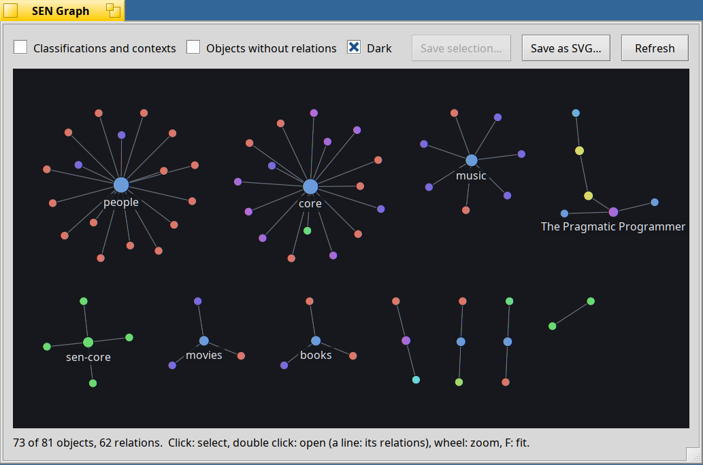

**Opening it**

- Hold the **SEN key (Command)** and click the knot in the Deskbar, or choose **Graph...** in its menu (below *Ontologies*).
- In Akita, hold the SEN key and **double-click a file**: the graph opens centred on that file, which is selected. The same happens when a file is selected in Akita and you click the knot with the SEN key held.
  (Without Akita, or with nothing selected, the graph opens as a whole.)

**What you see**

- The colour of a dot is its type (the entities, relation types and documents each have their own), its size grows with the number of its relations. The names of the dots with many relations are shown; the others when you zoom in or select something.
- A relation is stored in both directions, so a line has the labels of both ("parent of / child of"). An arrow means that the relation goes only one way.
- Not shown at first: the classifications and contexts that files are in (they would connect everything), the objects that have no relations, and the ontologies (what defines the types: the meta level of SEN, with their relations). Each can be switched on above the graph.
  The window reads up to 2000 objects; if there are more, the status line says so.

**Working with it**

- **Click** a dot: it is selected, its lines are emphasised, what is not connected to it is dimmed, and the names of its neighbours are shown. **Double-click** opens the file, as a double click in Akita does.
- **Click a line** to select the relation, **double-click it** to open the folder of the relations of that type of the dot nearer to where you clicked (like *Open related...*: a relation is in both objects).
- **Point at a dot or a line** and a translucent **card** appears next to it. The card of a dot has its picture, its title, the attributes that its type shows (the same as in Shoji) and the number of its relations;
  the card of a line has the icon and the label of the relation as seen from the end that you are nearer to, the two objects and the number of targets of that end. Move the mouse onto the card, it lights up, and **a click
  opens** the file or the folder of the relations, as a double click does. **Preview** above the graph switches the cards off.
- **Drag** to move the graph, the **mouse wheel** zooms around the pointer (or `+` and `-`), **F** fits all of it into the window again. When you resize the window the graph is fitted again, as long as you have not zoomed or moved it.
- **Dark** switches between a light and a dark look. It follows the colours of the system until you choose, and then the choice is remembered (the setting `SEN:darkMode` in `~/config/settings/sen/sen.settings`).
- **The graph is live**: it watches the files of its objects and follows new and removed ones, so an enrichment that makes people shows up while you look. Changes are read after a moment of quiet, and your zoom, position and selection stay. It watches up to 1500 files. If a file that you asked for has no relations (yet) the window says so, and shows it when it gets some.

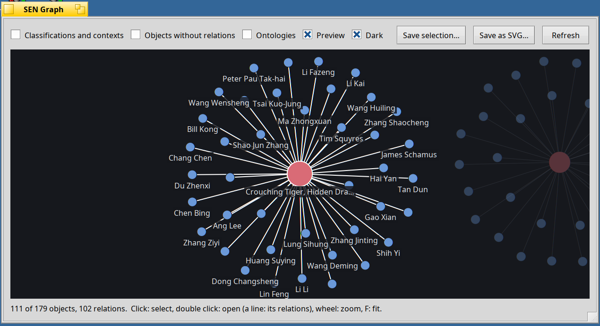
- **Refresh** reads the objects again.
- **Alt+W** closes the window; the server keeps running.

**Saving it as SVG**

- **Save as SVG...** saves the picture of the window as it is: its size, zoom and position, the selection emphasised, the names that you see.
- **Save selection...** (enabled when something is selected) saves the selected dot with the dots that it is directly connected to, or the two ends of a selected line, laid out as in the graph. The name that is
  suggested for the file has no spaces or other characters that mean something in a path or a URL.

## The settings window

**Settings** in the Deskbar menu opens one window for everything that can be adjusted. On the left is a tree, on the right the form of the selected node (it is the form of Shoji, so it works as everywhere in SEN). **Defaults** puts the node back to its standard values, **Revert** (enabled after a change) takes back what you changed.

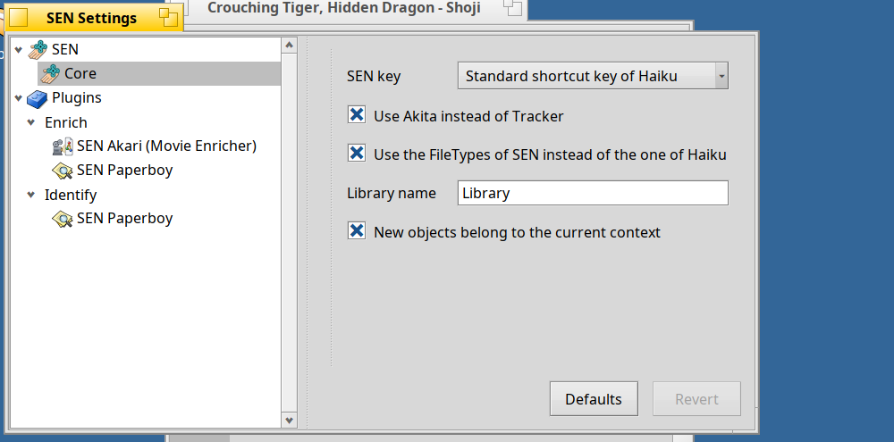

**SEN › Core**

- **SEN key**: the key that switches dragging, the knot and Akita to SEN (the standard shortcut key of Haiku, or Option, Control or Shift).
- **Use Akita instead of Tracker**: takes effect at the next login (it is a file of the user for the launch daemon, which the command `akita` writes; `akita start` and `akita stop` switch at once).
- **Use the FileTypes of SEN instead of the one of Haiku**: also in the Preferences menu of the Deskbar (a link of its own in `~/config/settings/deskbar/menu/Preferences` takes the place of the one of Haiku).
- **Library name**: the name of the [Library](#the-library) folder (`Library`). An existing folder is not moved.
- **New objects belong to the current context**: see [below](#the-library).

**SEN › Location** is there if the location server [Basho](https://github.com/sen-laboratories/basho) is installed (it is not part of SEN: it is a service of its own that SEN and any other program can ask where the computer is, roughly). Its settings are shown here as those of a plugin are: whether the place may be looked up from your internet address (*Ask me*, *Allow*, *Never*: the lookup tells a service on the internet your address, so you are asked first), **how much programs may know** (the city as looked up, a radius of 10 to 500 km, the region, the country only), and under that **a table of the programs that have asked** where the computer is: a box for whether the program may know it at all, and a menu with its own limit (more than the others, or less). Click a box to turn it over, click a level to choose another. A change counts at once, for programs that are asking already, too. `location config` and `location grant` do the same from the shell.

**Plugins** has the settings that are the same for all plugins:

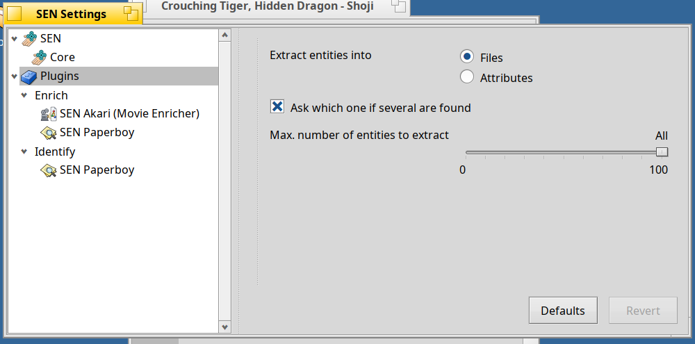

- **Extract entities into**: *Files* makes a file of every person (author, actor...) that a plugin finds; *Attributes* only writes their names into the attributes of the file.
- **Ask which one if several are found**: when a book, a movie or a paper has several candidates, a window lets you choose; switched off, the best is taken.
- **Max. number of entities to extract**: how many people a plugin makes of a long list (the first ones). A slider from *None* (the left end) to *All* (the right end, no limit).

**Enrich** (below *Plugins*) has the setting **Enrich automatically on demand**: when you open a relation of a place that has no position yet (the things nearby a place that you made with an address only), the place is enriched first (its address is looked up with OpenStreetMap and Wikidata) and the relation is worked out afterwards. Switched off, a notification says that the place has no position yet, and you enrich it yourself.

Below **Plugins** are the kinds of plugin (*Enrich*, *Identify*...) and under them the plugins **that have settings of their own**: Paperboy (your e-mail address and the OpenAlex key for friendlier servers, which sources to ask, whether to rename the file after the paper and with which pattern) and Akari (the TMDB key and the language of the descriptions). A plugin that has nothing to set is not listed. A plugin may refuse a value and says why. A key is shown as dots.
Choosing a heading selects the first node below it.

## The Library

What SEN or a plugin makes new, such as the people of the authors of a paper, the cast of a movie or a label, **does not go into the folder of the file** that it was found for, but into the **Library**:

- The Library of the default context is **`~/Library`** (the name is a setting of Core), the one of another context is **`~/Library/<name of the context>`**. A context can name another folder in the attribute `SEN:libraryPath` of its folder.
- It has **one folder for each type**, named in the plural: *People*, *Books*, *Movies*. The folders are made when they are first needed.
- A person that exists already (found by its name and its key, in the Library or next to a file where an earlier version put it) is **updated where it is**, not made again.
- From the command line: `sen --library person` prints the folder for a type (`--create` makes it, `--context <name>` asks for another context).
- **Add to Library:** select a person, a book or another entity (also in the window of a relation, such as the *Authorship* of a paper) and choose **Add to Library** in the context menu. The item adds to the **current context**; its submenu lists all the contexts, the current one in **bold**, and adds to the one that you choose (only there: the copies in other Libraries stay as they are). The file is copied into the folder of its type in that Library, with its attributes; if it is there already (or a file of that name is), nothing is copied and the notification says so.

**New objects belong to the current context.** What is made new while a context is the current one (the one that is checked in the *Context* menu) is related to it by an **Association**, as if the context were [sticky](#sticky-classifications): a file made with *New*, a relation, the people that a plugin makes. With the context's *Open related...* you see its objects. Switch it off in *Settings › SEN › Core*: then only what you have made sticky yourself is applied. The default context is every file and is never applied.

## Open and Open with

The context menu and the File menu have one item for both: **Open** opens the files with their preferred application. Hold **Shift** when you open the menu and it shows **Open with...** instead: choosing it asks for the application (with the choice to make it the preferred one), and its submenu lists the applications that can open the files, as before. (*Enrich* works the same way: with Shift it is *Enrich (Overwrite)*.) The keys **Command+O** and **Command+Control+O** do not change.

## Enriching a file

*Enrich* in the context menu of Akita (with **Shift**, *Enrich (Overwrite)*, which replaces what the file has) asks the plugins that know the file's type to look it up:

- **PDFs of scientific papers** (Paperboy): the attributes of the paper from OpenAlex, arXiv, Semantic Scholar and DBLP, and the authors as people.
- **Books** (BERT, from OpenLibrary): the attributes, the cover as the thumbnail, the authors as people.
- **Movies** (Akari, from The Movie Database, TMDB): title, year, duration, genres, links, the poster as the thumbnail; the director, crew and cast as people, each with a **Contribution** relation (role, character, place in the credits). Akari needs a free **TMDB key**: register at themoviedb.org, copy the *API Key* (or the *API Read Access Token*) from *Settings › API* into *Settings › Plugins › Enrich › SEN Akari*.

- **Places and locations** (Spaces, from OpenStreetMap and Wikidata): name, kind, position, address, links and a picture; see [Places and spatial relations](#places-and-spatial-relations).

While a plugin works, a **notification** says so (*Enriching movie*, *Enriching book*, *Enriching paper*), and the result (*Movie enriched* with what was found, or why nothing was) takes its place.

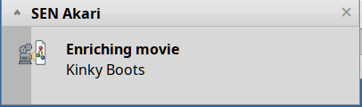 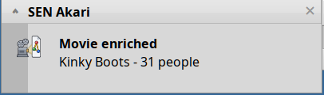

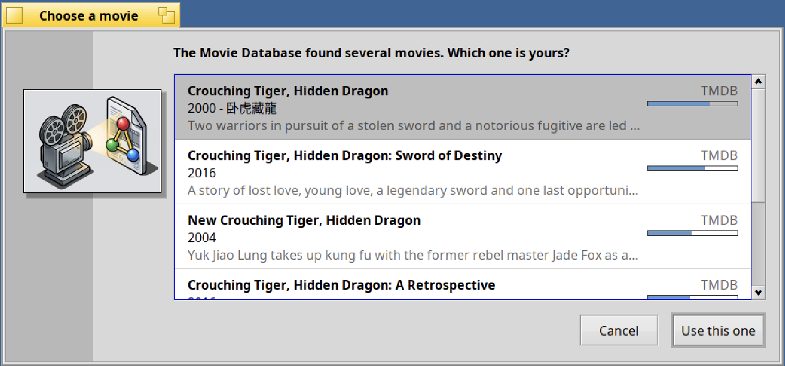

If several candidates are found, a window asks which one is yours (unless you switched that off). *Cancel* changes nothing. The file keeps its type for Haiku; SEN adds its *semantic type* (*Movie*, *Scientific paper*...), so Shoji and the *Attributes* menu show what fits. The people are made as set under *Plugins* and put into the [Library](#the-library). Genres, countries and links are written as lists with the separator that the attribute defines (a comma), so Shoji shows one entry for each.

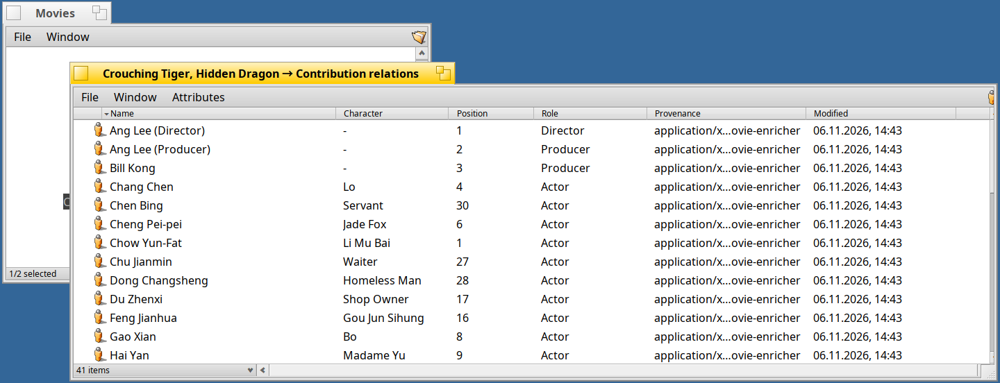

A person who has more than one Contribution to a movie (a director who is also a producer) is listed once for each, and then the entries are named by their role: *Ang Lee (Director)*, *Ang Lee (Producer)*. The **Provenance** column of a relation says which program made it. A related file that has been deleted keeps its entry in the window, with the **broken-link icon** of Haiku, and shows in the *Open related* menus as a disabled entry (*Missing file*, or the name the relation knew).

## Places and spatial relations

Beta 6 adds the ontology **SEN Spatial**. A **Place** is something with a name and an identity (*Karlskirche*, *Vienna*, *Café Central*); a **Location** is only *where* something is (the position of a photo, a meeting point). Both are made with *New › Spatial* in Akita, and both have a name, a kind, a position, a bounding box, an address, links and a picture.

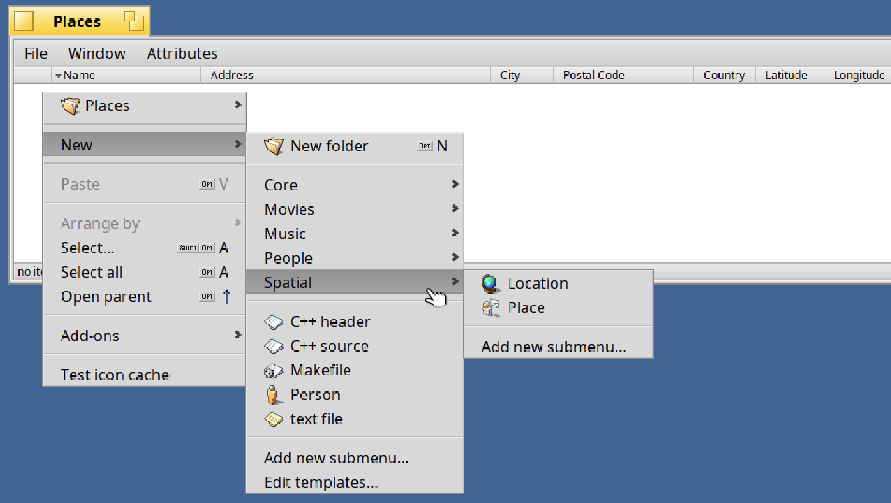

### Looking a place up (Spaces)

Give a Place or Location a name (the title, or the name of the file) and, if you know it, the city, region or country, then choose **Enrich**. **Spaces** (the place enricher) asks [OpenStreetMap](https://www.openstreetmap.org) (Nominatim) and Wikidata and writes what it finds: the other names, what kind of place it is, the position, the bounding box and outline, the address, the links (OpenStreetMap, Wikidata, Wikipedia) and a **picture** (a photo, a coat of arms), credited with its license. If several places fit, a window asks which one is yours; the best fit is first, each with its kind, the line of a railway station or who runs it (a metro station is told from the train station of the same name) and the distance if the file has a position.

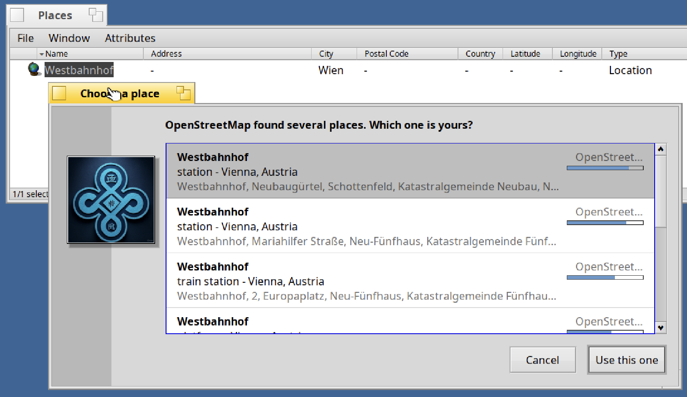

- **A file that says where it is** (a city, region or country field) is searched in that country only: *Westbahnhof* in *Wien* never offers the one in Budapest. Without that, the search is worldwide and the first answer may be in another country: add the city or the country.
- A **position** that you gave is used to rank the answers; it is **not sent**. The **GPS position of another file**, such as a photo, is looked up only if you switch on *Use GPS location for lookup* in the settings of Spaces.
- No key is needed. Spaces asks at most once a second, keeps every answer for a week and names itself, as the services ask. Data © OpenStreetMap contributors (ODbL), descriptions from Wikidata (CC0), pictures from Wikimedia Commons under their own licenses.

### Places in Shoji, with a map

A Place or Location opens in **Shoji** as a form with a **map** next to it and a pin where the place is (the map is zoomed to fit the bounding box). The **secondary mouse button** on the map opens a menu to choose the **style**: OpenTopoMap (relief), OpenStreetMap (standard), Humanitarian (warm, clear) or CyclOSM (cycling), all public servers that need no key, with the credit of the style written on the map; the first item goes back to the default. The default for all views is a setting: *Settings › Plugins › Navigate › SEN Spatial Navigator › Map style*. If a server does not answer, the standard map stands in.

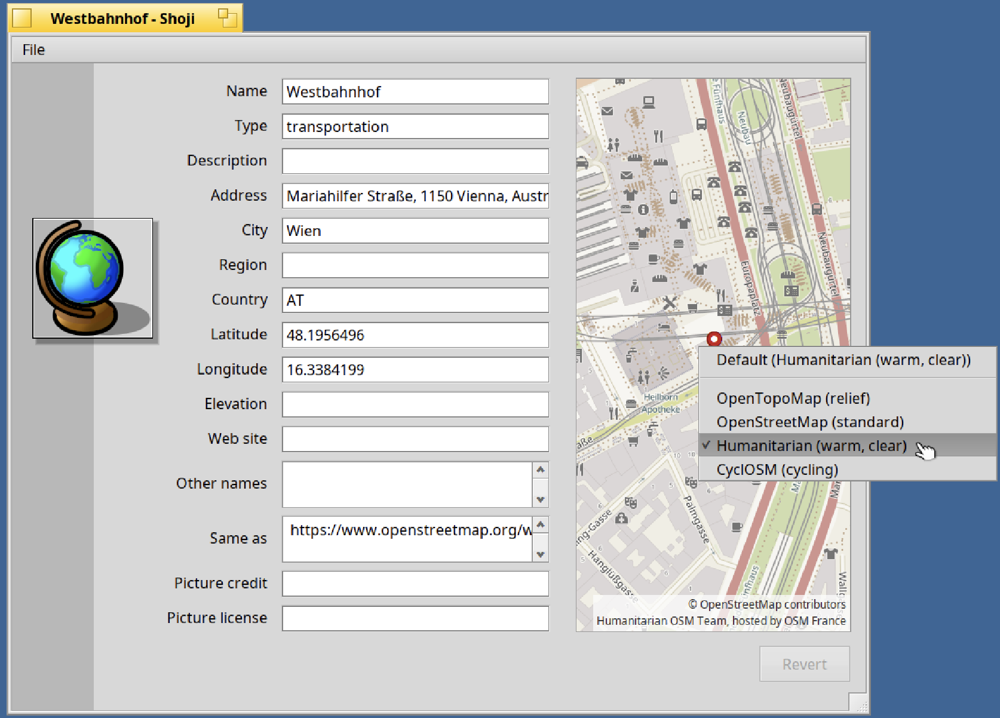

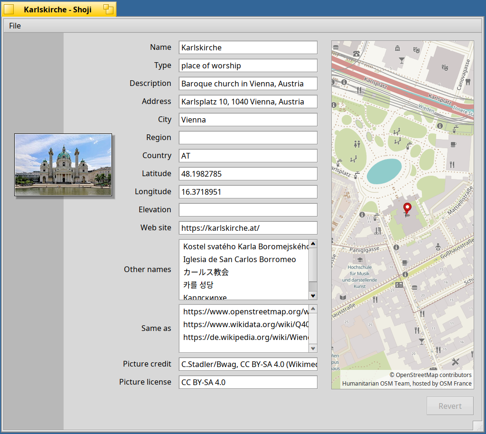

### Spatial relations

Open the **Spatial** group in *Open related...* at a place:

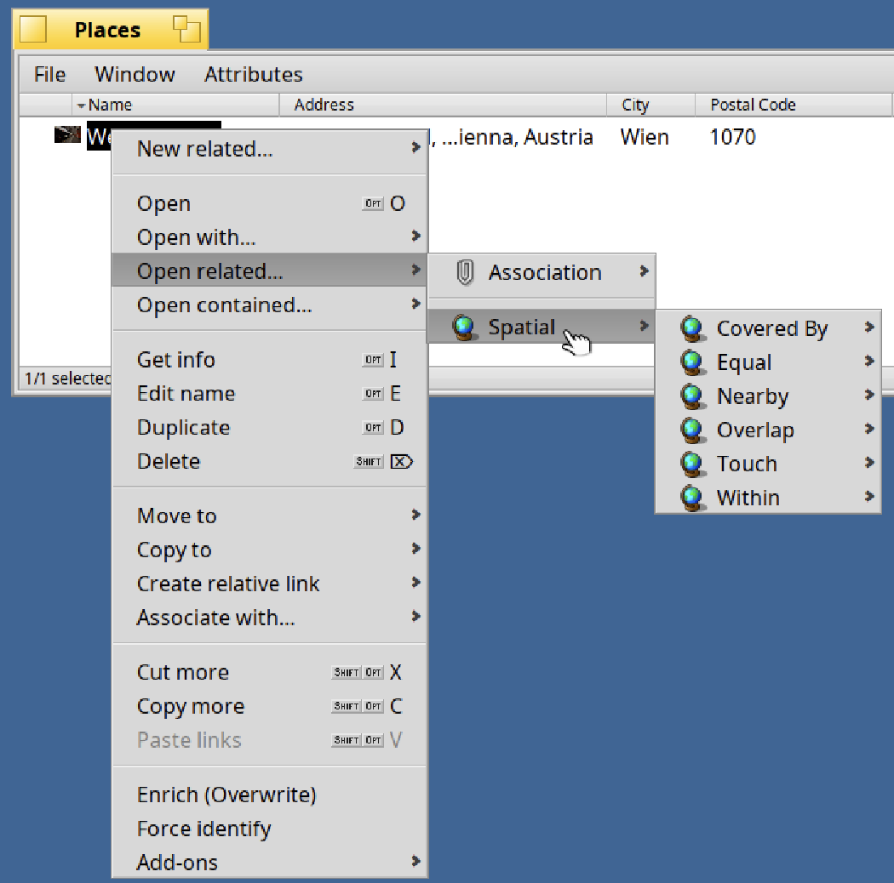

- **Within** and **Contains**, **Covered by** and **Covers**, **Touch**, **Overlap** and **Equal** are the relations between places and regions in the *Region Connection Calculus* (RCC-8). They are **not stored**: they are worked out when you open them, from the outlines of the places you have (with GEOS), and for *within* from Wikidata's "located in" chain (the *Stephansdom* is in *Innere Stadt*, *Vienna* and *Austria*). A place of the chain that you do not have yet is made in the Library, ready to enrich. They are always right, also after an outline was corrected. Each relation has a **Kind** in words (*non-tangential proper part*...) and a hidden **RCC-8** code; its **provenance** says whether the plugin or Wikidata said it.
- **Nearby** lists the named things that OpenStreetMap knows around a place (shops, cafés, sights, stops, parks), each with what it is (*cafe*, *place of worship*) and its **distance in metres**, nearest first and notable ones before shops. Each one is a Place in the Library (the first dozen with a Wikidata item are enriched in the background, with picture). Things that are gone (closed, abandoned, only planned) are left out. It asks the **Overpass API**, which can take half a minute when busy: the menu opens at once with *Fetching relations…* and a turning spinner, and the items come when the answer is in. The server (several public mirrors, or your own), the search radius, the most things and how long answers are kept are settings of the spatial navigator.
- **Located near** (stored) says where a file is: Spaces makes it for a Location or photo that it looked up.

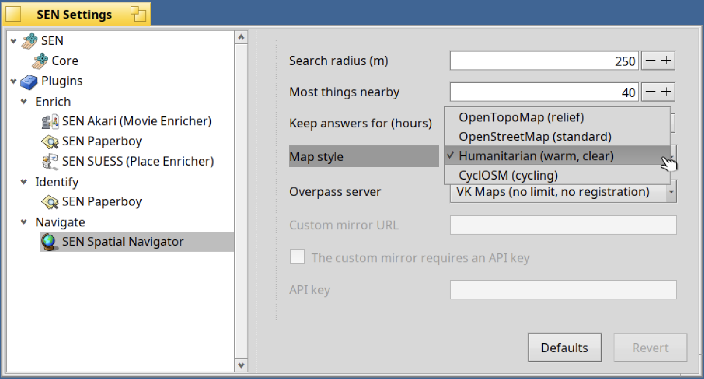

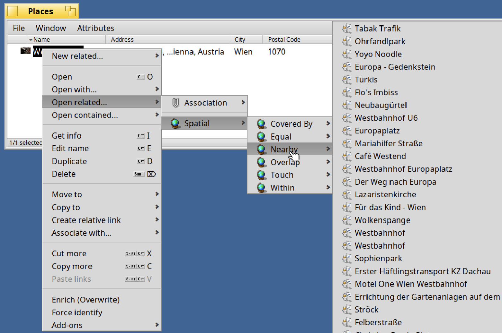

### Folders of spatial relations

Choose the group itself, **Open related › Spatial**: a window opens with a **folder for each spatial relation** of the place (*Covered By*, *Equal*, *Nearby*...), empty at first, with the globe-in-a-folder icon. A folder is filled **when you open it** (and again after five minutes, if you open it again), so nothing is asked that you do not look at. In *All relations*, a relation that a plugin works out (like *Nearby*) is such an empty folder too.

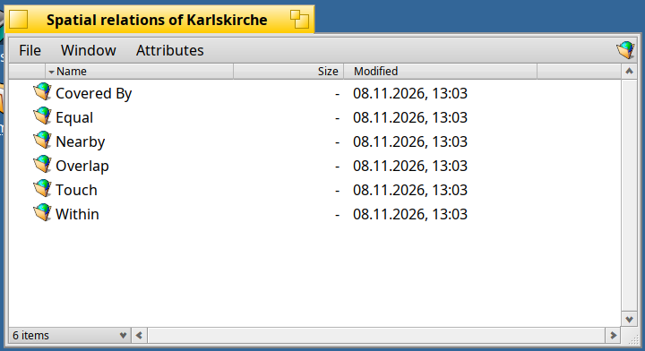

To **keep** one, drag it onto your Home folder or the Desktop, as for any folder. The copy keeps the attributes that say where it comes from and **fetches again when you open it**; you can sort, copy or drag out its files like those of any folder.

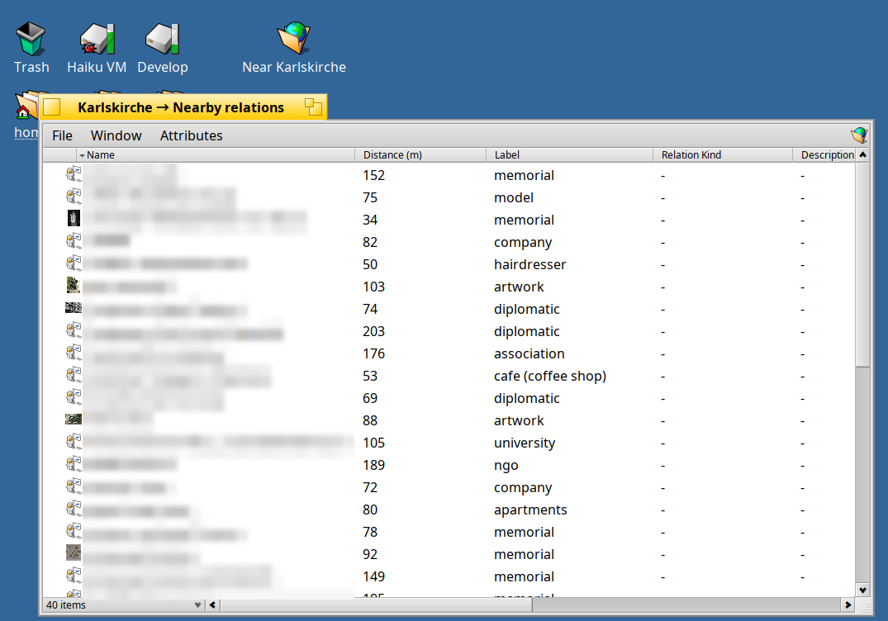

## Calendar files and events

An invitation or a calendar entry (`.ics`, also the old `.vcs`; from Google, Outlook, Apple, Thunderbird and others) is an **event** once SEN has read it. Select the file in Akita and choose **Enrich**: the file is typed as an *Event*, its
time, place, organizer, status, the link of an online meeting (and its service: Zoom, Google Meet, Microsoft Teams, Webex, Jitsi, GoToMeeting, Whereby, Skype) and the rest are written into its attributes, so that you can show them as columns,
sort by them and search for them, and the file is **named after the event with its date and time**: `2026-11-12_0930_Planning.ics`. You can change the name in the settings of the calendar extractor (*Name pattern*, with the tokens `{date}` `{time}` `{year}` `{month}` `{day}` `{hour}` `{minute}` `{title}`; the default is `{date}_{time}_{title}`). The description is kept as a **Markdown file** beside it (`2026-11-12_0930_Planning.md`) with its links and formatting.
The times in the attributes do not depend on your time zone setting: Akita shows them in the zone that you set. Nothing is sent over the network.

A file with **several events** (an export of a calendar) becomes a **Calendar** that holds them: it has the name of the calendar, the number of events and the time that they cover.

Open the relations of an event (*Open related*, group *Temporal*, where the relations between events are as well):

- **Attendee** lists the people of the event, each with their role (organizer, required, optional, resource) and their *response* to the invitation (accepted, declined, tentative, needs action). The response belongs to the relation between the event and the person, not to
  the person. Each person is a *Person* in the Library (found by the e-mail address, so the same person is not made twice); the person that you are is marked *you* (set **Myself** in the settings of the calendar extractor).
- **Takes place at** is the place of the event, a *Place* in the Library (with its coordinates if the file has them; Spaces looks it up).
- **Series** shows the instance of a repeating event just **before** and **after** this one, as the rule of the file says (with its exceptions and the instances that were moved). The event that has the rule is the series itself, seen from **today** as a calendar app shows it: its *next* is the next time it comes (the next birthday), its *previous* the last time it was. An instance that the file moved or changed has the instances around it.
- **Description** opens the Markdown file of the event.
- **Events**, at a calendar, are the events that it holds. They are contained in the file as the outline of a document is: the menu of the calendar shows them as a list, in order of their start. The window of an event (Shoji) shows what the file says, also how it repeats (in words), the people with their roles and answers, the status and the links of the page and of the online meeting (click the label).

The events in the folder of the Events relation are only **items** at first: a copy of such a file would copy the relation. To **keep an event as an event**, select it (or several) and choose **Add to Library**: the calendar extractor makes the event a calendar file of its own in the Library (`Events`), named after its date and time, enriched like an event that you received alone. Keeping it again finds the file that is there. You can also **drag the events out** of the folder (or use *Copy to*): they become events in the folder where you drop them. Choosing **Open related** on such an item shows the relations of the event, for example the events before and after it.

The folders of these relations are made when you open them: look at them (peek), or keep them. The instances of a series and the events of a calendar are places in the same calendar file, as the pages of a PDF are.

In the settings (*Plugins*, under *Enrich*, *Identify* or *Navigate*: *SEN Calendar Extractor*) you can switch the renaming and the Markdown file off and set **Myself**: type your name and address (`Name <address>`) or choose yourself from the list of the people that SEN knows.

### How an event repeats, and what the file says

*Repeats* is a field with a list (every day, every weekday, every week, every month, every year; other words are allowed, such as *every 2 weeks*). **What is in the attributes of the event counts**: the *Series* relation (the next and the previous time, seen from today) and *Takes place at* use *Repeats*, the start, the end and the *Location* as they are now, also when they differ from the calendar file that the event was made from, which is never changed. An event that you made by hand, with no calendar file behind it, has a series, too.

Behind *Repeats* (the words for you) there is a second attribute, *SEN:recurrence*, which is not shown: the rule as programs read it (`FREQ=WEEKLY;INTERVAL=2`), which can say more than the words (on Monday and Wednesday). When you choose a value or type simple words (*every 2 weeks*) in Shoji or in a column of Akita, the rule follows. Words that cannot be read (*every second Friday after payday*) stay as they are and the rule stays as it was. The list of *Repeats* ends with **Custom…**: a window to set how often (every 2 weeks), on which weekdays, and how long (never, after 10 times, on a day), with the words as you will see them; *OK* writes the words and the rule, *Doesn't repeat* takes them away. Clearing *Repeats* says that the event does not repeat, also when its calendar file says it does. A script that changes one of the two should change both (or take the words away): if the words say something readable that differs from the rule, the words win.

### Event types

An event has a **type** (the field *Event Type*, the attribute `SEN:eventType`): what kind of event it is. The ontology knows the common kinds and maps them to Wikidata: *Meeting, Conference, Telephone call, Video conference, Party, Birthday, Anniversary, Wedding anniversary, Jubilee, Death anniversary, Wedding, Funeral, Graduation, Baptism, Dinner party, Housewarming, Farewell party, Baby shower, Ceremony* and, since beta 8, the days of the calendar: **Holiday, Public holiday, National day, Religious holiday, Festival** and **Observance**. You are not limited to them: any other text may be typed.

The type is a field with a **list that follows what you type** (the same in Shoji and in the list view of Akita): it opens below the field and shows the types that **begin** with your text; if there are none, those that **contain** it anywhere. The characters that matched are drawn **bold**. Use the arrow keys to move in the list, **Enter** to take the selected entry (or the one that the text names), **Escape** to close it. The small **arrow** at the right end of the field opens the whole list, also while the field is empty.

### Days and times in Shoji

The **Start** and the **End** of an event (or of anything else that has a time) have a control for the **day** (in the order and with the separator of your locale; type it as it is written, or click the arrow button next to it for a calendar) and one for the **time of day**. **All day** leaves the time out (the time field is dimmed). Typing is a *pending* change: **Enter**, leaving the control, choosing a day in the calendar or checking *All day* completes it; **Escape** puts back what is stored. **Enter** keeps the edit in every field of the form, **Escape** reverts it.

**The end of an event is never before its start.** If you type an end that is before the start, it becomes the start; if you move the start past the end, the end moves with it and keeps the length that the event had.

A time that is **not exact** (*about May 1994*, *some year of the 2020s*) is written in the *Extended Date/Time Format* (EDTF): `1994-05~` (about), `1994?` (uncertain), `202X` (some year of the 2020s). SEN keeps it as the **earliest** moment of a start (the **latest** of an end), so that sorting and searching work, and keeps the text beside it (`SEN:startDateEdtf`, `SEN:endDateEdtf`). Such a value is typed as text in the field of an event that already has one; the date and time controls are for exact times.

### Temporal relations: before, meets, overlaps

*Open related*, group **Temporal**, at an event, shows how it lies in time to the other events (and to any file that has a start): the relations of **Allen's interval algebra**, worked out when you open them (they are not stored, so they are right after you corrected a time):

- **Between** (the files *before* and *after* the event), **Meets** (one ends where the other begins), **Overlaps**, **During** (and *contains*), **Equals**. Each file in the folder says how it is related *as seen from the event you opened*.
- Two days in a row **meet**; a time that is not exact counts with its widest extent, so a relation is never claimed that the time does not allow.
- A **calendar** (the umbrella of its events) is left out: its time is the time that its events cover.
- The relations are offered at **every file that has a start** (`schema:startDate`), whatever its type: a photo or a document that has one has them, too.

<!-- screenshot to add: images/beta8/temporal-relations.png (Open related, group Temporal, at an event) -->
<!-- screenshot to add: images/beta8/shoji-event.png (an event in Shoji: Event Type list, Start/End controls) -->
<!-- screenshot to add: images/beta8/akita-edit-cell.png (the outlined cell and the list of event types in the list view) -->

## Editing an attribute in the list

In the list view of Akita, **the whole cell** of an editable attribute is the place to click (an empty one too), as in a spreadsheet. A click selects the file and **outlines the cell at once** (a dotted grey line); after a short pause the edit starts, and the field fills the cell. A double click that is faster than the pause still opens the file. **Enter** accepts the edit, **Escape** reverts it, clicking another cell accepts it and starts the next. The **name** keeps the area of its text (the empty space after it starts a rubber band selection): its first click selects, a second one renames. Shift and Command clicks only select.

### Finding by time

In the **Find** window (*Find...*, *by attribute*) a time attribute offers **before**, **after** and **is**; the text field of the row has the same calendar arrow. *Is* means within the period that you typed (a day, a month `2026-11`, a year `1994`, a minute); *after 2026-11-12* means from the 13th on. The times of the ontologies are kept as 64-bit integers and BFS reads a date in words as 32 bits, which gave wrong answers; Find now asks with the integer.

### The right control for the kind of attribute

What is edited in the list follows the **type of the attribute** as the ontology (or FileTypes) says it:

- A **yes/no attribute** is a **check box** in the cell. One click turns it over (the cell is outlined first, as above; a faster double click still opens the file). The check box is **greyed** and does nothing where the attribute is read-only or the file is on a volume that cannot be written.
- A **time** (day and time of day) and a **day** (an attribute that the ontology calls a *date*, such as a birthday or the date of publication, which is shown as a day only) have a small **arrow** at the right end of the field: it opens a **calendar** below the cell (month and year buttons; for a time also hour and minute and *All day*). Picking a day ends the edit with it. You can also type: `2026-11-12 09:30`, `2026-11-12`, or a time that is not exact such as `1994-05~` (a start or an end), or words such as `12 Nov 2026 9:30`; a text that is no time is refused and nothing is written. An empty field removes the attribute. On a volume that cannot be written there is no arrow.
- The **end** of an event is never before its **start** here either: an end that is typed before the start becomes the start, a start that is moved past the end takes the end with it.
- A start or an end that was said fuzzily (`1994-05~`) is **shown as it was said**; times sort correctly also before 1902 and after 2037.

## Updating Akita

A running Akita does not notice a new version of its program by itself. Since beta 8 it **watches its package**: when `pkgman update` has installed a new Akita, a small alert asks *Later* or *Restart*; *Restart* starts the new Akita and quits the old one (its windows come back as they were).

## Shoji, the form for a file

Shoji opens a file (a paper, a person, a movie...) as a form: the Deskbar menu of SEN and *Open With... Shoji* start it, and in its settings it can be made the application for more types. A few things to know:

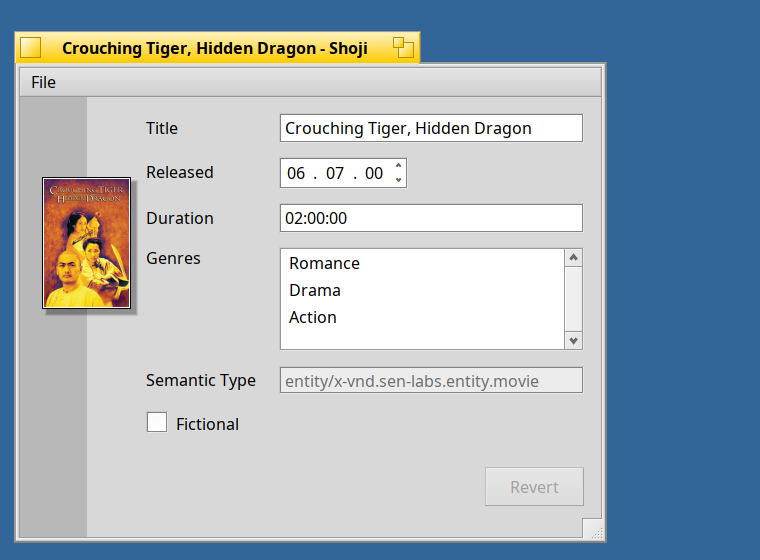

- A **duration** is shown and typed as `hh:mm:ss` (stored as ISO 8601, `PT2H16M`); a **date** has a date control.
- A **list** (genres, groups, links) shows its entries one below the other: double-click to change or add one, *Delete* removes one.
- A **field that cannot be changed** is greyed and read-only, its label stays readable.
- A **click on the picture** shows it larger; it closes with the window.

## Relating files with Command+drag

Hold the **Command** key (the Apple key on a Mac keyboard, Alt on a PC one; another key can be chosen in the Settings of the SEN item in the Deskbar) while you drag files onto another file or folder, and let go: instead of copying, moving or opening anything, a menu
with the relations that can be created between the files opens at the pointer. Choose one and SEN creates it (in both directions, for
most relations), or press Esc or click outside the menu to cancel. The files stay where they are.

- **A label:** hold **Shift** while you drop the files (it is remembered, so you can let go and pick from the menu) or while you choose the
  relation in the menu, and a small window asks for a label for the relation (it can be
  left empty). Cancel (or Esc) creates nothing. The opposite direction keeps the label of its own that the relation defines, if it has one.
- **Several files:** select the files to relate and drag them. If you drop them on a file that is part of a selection, all the files of
  that selection are the target: the relation is created between every dragged file and every target file.
- **Which relations are offered** depends on the kinds of the files: only relations that fit all files on both sides are shown. A label
  (classification) and a file are related by an association, two files by the other relations.
- Files in the Trash and the Desktop folder itself have no relations. Dropping files on themselves does nothing.
- If a relation could not be created (for example because it is read-only), a message says how many failed and why.

## Deleting files that have relations

When you delete a file (Move to Trash, or Delete) that has relations, Akita says that it still has relations and asks whether you really want to delete it (the button *Show in Tracker* opens the folder with its relations). If you do,
the relations of the file are removed on both sides together with it, so that no other file keeps a link to a file that is gone. (Relations that point to files that are
already gone are removed without asking. The relations of the ontologies are read-only and stay. Labels and the like that are put on a file go with the file anyway.)

## Sticky classifications

What you make while a classification is **sticky** is put into it automatically: a new file (*New* in a folder, a new file for a relation) is labelled with it, and a relation
that you make lists it, so that you can filter by it later. In the menu of the SEN item, **Shift+click** a label, topic, collection... (or a context in the Context menu) to make it
sticky: it is shown in **bold**. Shift+click it again to let it go; a plain click shows the files of a label as before. Only one context is sticky: choosing another context
(plain click) lets the sticky one go, and Shift+click on a context makes it the current one, too. The default context cannot be sticky (it would be everything).
Choosing the *Context* item itself opens the folder of the contexts. The **current context** counts as sticky by default (see [the Library](#the-library)).

## New objects from the ontologies

An ontology that you install brings its entities (Book, Person...) to the **New** menu of Akita: they are templates in the folder *Tracker New Templates*, a submenu for each
ontology. You can make an object of a new type at once; templates that you delete or change are left alone, and removing the ontology removes only those that it made.

## Relations in folders

*New related...* creates a file for the relation. With the **Shift** key held when you choose the kind of file, Akita asks for a label of the relation first (as when you drop a file on another with Shift pressed).

A relation connects a file with another file: a book with its author, a PDF bookmark with a page, an ontology with the types it provides.
You see a relation as a **folder of files**, like any folder: choose *Open related...* in the context menu of a file, pick the kind of relation, and
a window opens that has one file for each relation.

An **ontology** (in the folder `~/config/settings/sen/ontologies`, which the *Ontologies* item of the Deskbar menu opens) is shown as such a folder: it has the icon of a folder of relations, and double-clicking it
in Akita opens its *Dependency* relations, that is what it defines and what it needs. In the menu *Open related... > Dependency*, choosing a type opens it in FileTypes.

### A relation file stands for the file it points to

The files in such a window are **placeholders** for the files at the end of the relations. They show the details of the relation in their columns
(the label, the page of a reference, ...), but they *represent the other file*:

* **Double-click** opens the file that the relation points to, not the placeholder. The details of the relation come along: a reference to page 12 of a PDF opens the PDF at page 12.
* **Open related...** and **Open contained...** on a placeholder show what is related to, or contained in, the file that it points to.
* **Changing a column** of the placeholder (the label, for example) changes the relation itself.
* **Deleting** a placeholder removes the relation, not the file it points to. Dropping a file into the window adds a relation to it.

Some relations are read-only, e.g. what an ontology provides: you can look at them, but not change or remove them.

### Folders inside a relation window

A **folder** in a relation window is a relation of its own (a relation with several parts, an *n-ary* relation, e.g. a chapter with its sections). What you do with the folder
you do with that relation.

Soon: *New related...* on a relation, or on such a folder, will add another part to it (a binary relation becomes a relation of three files, and so on).

### Choosing the columns

The **Attributes** menu lists the attributes of the type of each file in the window and also those of its *semantic type* (what the plugins found out about the file, e.g. a scientific paper), so you can show them as columns, too.

In the **Attributes** menu, each kind of relation has its own list of columns. A relation window shows all of them at first. In the menu of the column titles (right click),
Shift+click keeps the menu open so that you can choose several in a row, and choosing the menu of a kind of relation selects all its columns.
