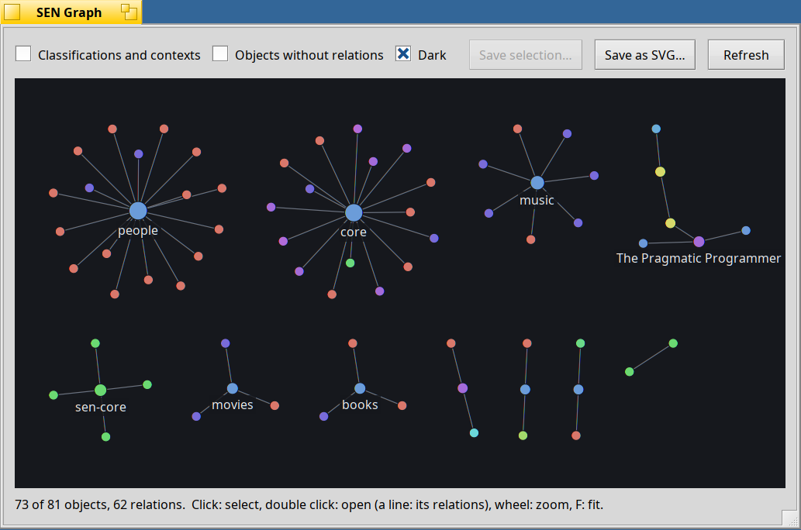

<!--
SPDX-License-Identifier: MIT
SPDX-FileCopyrightText: 2026 SEN Labs e.U.
-->

# SEN user guide

## The SEN item in the Deskbar

The SEN server puts its knot into the Deskbar when it starts. **Clicking** it opens a window with all the objects that SEN knows: the files that have
a SEN:ID, as a flat list. With the **SEN key (Command)** held, the click opens the [graph](#the-graph) of the objects instead. The menu (secondary mouse button) has:

- **Context** (choosing the item itself opens the folder of the contexts): the contexts that are set up (the folders of `~/config/settings/sen/contexts`, with their icon), the current one marked: choosing one makes it the current one.
  A new context ("New related... Context" in the file manager) is a folder there, with the type of a context.
- one menu for every kind of classification (**Labels**, **Topics**, **Projects**...): choosing the menu itself opens the list of them, and choosing one of
  its entries opens a window with the files that have it: a query for the classification ("Files with Label \"Homework\""), the same one as *Open related...* on the classification shows. (As in the menus of the file manager, every menu can be chosen itself.)
- **Info**: the overview of SEN as a tree: the objects on every volume, the types and relations that are installed with the number of files of each.
- **Check**: looks for inconsistencies (the same SEN:ID on several files, files of types that are not installed, volumes without an index).
- **Ontologies** (above Settings, they are configuration): the ontologies that are installed, each with its icon. An ontology opens down to its types (the entities, relations,
  classifications...), and a type to its attributes: choosing a type or an attribute shows it in FileTypes (the one of SEN, package `sen_filetypes`, if it is installed
  and not switched off in the Settings), choosing an ontology shows it in its folder. Choosing *Ontologies* itself opens the folder `~/config/settings/sen/ontologies`, which shows the version, description, author and schema of each ontology as its columns (in Akita), and *Update* has the ontologies of the packages
  installed now, which is otherwise done when the server starts and when a package comes or goes.
- **Graph...** (below Ontologies): the [graph](#the-graph) of the objects and their relations.
- **Settings**: the key of the SEN mode of dragging (Command, Option, Control or Shift), the use of Akita instead of Tracker (this takes
  effect at the next login: it is a file of the user for the launch daemon, which the command `akita` writes; `akita start` and `akita stop` switch at once) and the use of the FileTypes of SEN instead of the one of Haiku (also in the Preferences menu of the Deskbar: a link of its own in `~/config/settings/deskbar/menu/Preferences` takes the place of the one of Haiku).
- **About**, **Restart** and **Quit**. Restart quits the server and starts it again (it is the way to apply what a new version of the server brings). Quitting asks first: without the
  server, copies of files keep the SEN:ID of the original, which breaks the lookup by ID. It stays off until you start it again (`sen start`, or the next login).

The same information is on the command line: `sen info`, `sen types` and `sen check` (see the README of sen-core).

## The graph

The graph shows what SEN knows as a network: the **objects** (the files that have a SEN:ID) are its dots, the **relations** are the lines between them. Groups of objects that are
connected stand by themselves, so you see at a glance what belongs together: an ontology with the types it defines, a book with its author, a paper with the papers it cites.

**Opening it**

- Hold the **SEN key (Command)** and click the knot in the Deskbar, or choose **Graph...** in its menu (below *Ontologies*).
- In Akita, hold the SEN key and **double-click a file**: the graph opens centred on that file, which is selected. The same happens when a file is selected in Akita and you click the knot with the SEN key held.
  (Without Akita, or with nothing selected, the graph opens as a whole.)

**What you see**

- The colour of a dot is its type (the entities, relation types and documents each have their own), its size grows with the number of its relations. The names of the dots with many relations are shown; the others when you zoom in or select something.
- A relation is stored in both directions, so a line has the labels of both ("parent of / child of"). An arrow means that the relation goes only one way.
- Not shown at first: the classifications and contexts that files are in (they would connect everything), and the objects that have no relations. Both can be switched on above the graph.
  The window reads up to 2000 objects; if there are more, the status line says so.

**Working with it**

- **Click** a dot: it is selected, its lines are emphasised, what is not connected to it is dimmed, and the names of its neighbours are shown. **Double-click** opens the file, as a double click in Akita does.
- **Click a line** to select the relation, **double-click it** to open the folder of the relations of that type of the dot nearer to where you clicked (like *Open related...*: a relation is in both objects).
- **Drag** to move the graph, the **mouse wheel** zooms around the pointer (or `+` and `-`), **F** fits all of it into the window again. When you resize the window the graph is fitted again, as long as you have not zoomed or moved it.
- **Dark** switches between a light and a dark look. It follows the colours of the system until you choose, and then the choice is remembered (the setting `SEN:darkMode` in `~/config/settings/sen/sen.settings`).
- **Refresh** reads the objects again.
- **Alt+W** closes the window; the server keeps running.

**Saving it as SVG**

- **Save as SVG...** saves the picture of the window as it is: its size, zoom and position, the selection emphasised, the names that you see.
- **Save selection...** (enabled when something is selected) saves the selected dot with the dots that it is directly connected to, or the two ends of a selected line, laid out as in the graph. The name that is
  suggested for the file has no spaces or other characters that mean something in a path or a URL.

## Relating files with Command+drag

Hold the **Command** key (the Apple key on a Mac keyboard, Alt on a PC one; another key can be chosen in the Settings of the SEN item in the Deskbar) while you drag files onto another file or folder, and let go: instead of copying, moving or opening anything, a menu
with the relations that can be created between the files opens at the pointer. Choose one and SEN creates it (in both directions, for
most relations), or press Esc or click outside the menu to cancel. The files stay where they are.

- **A label:** hold **Shift** while you drop the files (it is remembered, so you can let go and pick from the menu) or while you choose the
  relation in the menu, and a small window asks for a label for the relation (it can be
  left empty). Cancel (or Esc) creates nothing. The opposite direction keeps the label of its own that the relation defines, if it has one.
- **Several files:** select the files to relate and drag them. If you drop them on a file that is part of a selection, all the files of
  that selection are the target: the relation is created between every dragged file and every target file.
- **Which relations are offered** depends on the kinds of the files: only relations that fit all files on both sides are shown. A label
  (classification) and a file are related by an association, two files by the other relations.
- Files in the Trash and the Desktop folder itself have no relations. Dropping files on themselves does nothing.
- If a relation could not be created (for example because it is read-only), a message says how many failed and why.

## Deleting files that have relations

When you delete a file (Move to Trash, or Delete) that has relations, Akita says that it still has relations and asks whether you really want to delete it (the button *Show in Tracker* opens the folder with its relations). If you do,
the relations of the file are removed on both sides together with it, so that no other file keeps a link to a file that is gone. (Relations that point to files that are
already gone are removed without asking. The relations of the ontologies are read-only and stay. Labels and the like that are put on a file go with the file anyway.)

## Sticky classifications

What you make while a classification is **sticky** is put into it automatically: a new file (*New* in a folder, a new file for a relation) is labelled with it, and a relation
that you make lists it, so that you can filter by it later. In the menu of the SEN item, **Shift+click** a label, topic, collection... (or a context in the Context menu) to make it
sticky: it is shown in **bold**. Shift+click it again to let it go; a plain click shows the files of a label as before. Only one context is sticky: choosing another context
(plain click) lets the sticky one go, and Shift+click on a context makes it the current one, too. The default context cannot be sticky (it would be everything).
Choosing the *Context* item itself opens the folder of the contexts.

## New objects from the ontologies

An ontology that you install brings its entities (Book, Person...) to the **New** menu of Akita: they are templates in the folder *Tracker New Templates*, a submenu for each
ontology. You can make an object of a new type at once; templates that you delete or change are left alone, and removing the ontology removes only those that it made.

## Relations in folders

*New related...* creates a file for the relation. With the **Shift** key held when you choose the kind of file, Akita asks for a label of the relation first (as when you drop a file on another with Shift pressed).

A relation connects a file with another file: a book with its author, a PDF bookmark with a page, an ontology with the types it provides.
You see a relation as a **folder of files**, like any folder: choose *Open related...* in the context menu of a file, pick the kind of relation, and
a window opens that has one file for each relation.

An **ontology** (in the folder `~/config/settings/sen/ontologies`, which the *Ontologies* item of the Deskbar menu opens) is shown as such a folder: it has the icon of a folder of relations, and double-clicking it
in Akita opens its *Dependency* relations, that is what it defines and what it needs. In the menu *Open related... > Dependency*, choosing a type opens it in FileTypes.

### A relation file stands for the file it points to

The files in such a window are **placeholders** for the files at the end of the relations. They show the details of the relation in their columns
(the label, the page of a reference, ...), but they *represent the other file*:

* **Double-click** opens the file that the relation points to, not the placeholder. The details of the relation come along: a reference to page 12 of a PDF opens the PDF at page 12.
* **Open related...** and **Open contained...** on a placeholder show what is related to, or contained in, the file that it points to.
* **Changing a column** of the placeholder (the label, for example) changes the relation itself.
* **Deleting** a placeholder removes the relation, not the file it points to. Dropping a file into the window adds a relation to it.

Some relations are read-only, e.g. what an ontology provides: you can look at them, but not change or remove them.

### Folders inside a relation window

A **folder** in a relation window is a relation of its own (a relation with several parts, an *n-ary* relation, e.g. a chapter with its sections). What you do with the folder
you do with that relation.

Soon: *New related...* on a relation, or on such a folder, will add another part to it (a binary relation becomes a relation of three files, and so on).

### Choosing the columns

The **Attributes** menu lists the attributes of the type of each file in the window and also those of its *semantic type* (what the plugins found out about the file, e.g. a scientific paper), so you can show them as columns, too.

In the **Attributes** menu, each kind of relation has its own list of columns. A relation window shows all of them at first. In the menu of the column titles (right click),
Shift+click keeps the menu open so that you can choose several in a row, and choosing the menu of a kind of relation selects all its columns.
